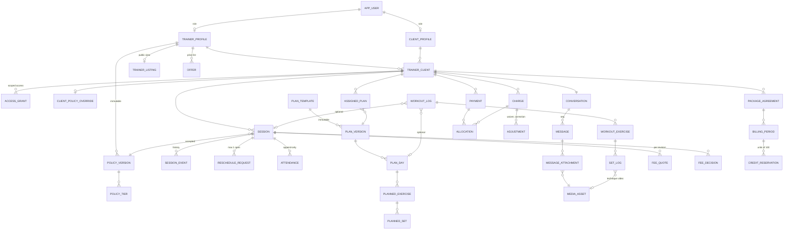

# Server database design

Status: draft v0.1 · 2026-11-11 · a proposal for team review, not an agreed decision.

The full DDL is in [database/schema-draft.sql](database/schema-draft.sql). It is meant to become the backend's first Flyway migration once the Ktor module exists. This document explains the shape of the schema and why it looks the way it does. It follows [initial-architecture.md](initial-architecture.md) §6–§10 and [infrastructure-aws.md](infrastructure-aws.md) (RDS PostgreSQL 16+), and keeps the column names and types the app already uses in `:contract` and the SQLDelight schema.

**Verified:** the DDL loads into `postgres:16-alpine`, and a synthetic smoke test passed. It checked that:

- a second open relationship for the same pair is rejected;
- policy versions, charges and plan versions cannot be edited;
- two overlapping confirmed sessions, or a session inside the trainer's buffer, are rejected, while overlapping *requests* are allowed;
- the §3.3 cash example (a 60 zł fee plus a 120 zł session, one 180 zł payment) clears the overdue flag;
- a replayed `operation_id` is rejected;
- a set uploaded twice stays one row;
- a PR ignores a heavier warm-up set;
- a technique video without a relationship is rejected;
- a session cannot have two open reschedule requests.

**Not done yet:** no backend code, no data-access layer, and no load or concurrency test beyond those constraints.

## 1. Main decisions

| # | Decision | Why |
|---|---|---|
| 1 | **One PostgreSQL schema per backend module**: `identity`, `catalogue`, `coaching`, `scheduling`, `training`, `messaging`, `media`, `billing`, `platform`. | Makes the §6 rule "a module owns its tables" visible. Cross-schema foreign keys keep integrity; cross-module *writes* go through the owning module's Kotlin interface. |
| 2 | **UUID primary keys.** Anything created offline on the phone (workout logs, sets, custom exercises, media, chat messages) uses the **client-generated UUID**. | A retried upload hits the same primary key, so the server deduplicates for free (§9.2). |
| 3 | **`operation_id uuid UNIQUE`** on every business command that is not naturally keyed: sessions, reschedule requests, plan publishing, assignments, fee decisions and every ledger row. | A retry can never book, publish or charge twice (§8). `platform.idempotency_key` covers endpoints whose result is not a single row. |
| 4 | **`timestamptz` for instants, plus an IANA zone** where local time matters (session, workout, availability, gym, user). | G9. Monthly free-cancellation counting and reminders need the session's zone, not the device's. |
| 5 | **Money is `bigint` minor units + `char(3)` currency.** | Same as `contract/Money`. Never `numeric` or floating point. |
| 6 | **Enum-like columns are `text` + `CHECK`** with `UPPER_SNAKE` values. | Adding a value is a one-line migration (Postgres `ENUM` types are awkward to change). `:contract` enums map to them. |
| 7 | **Immutability is enforced in the database.** A `forbid_update` trigger guards policy versions, plan versions, the ledger, session history, attendance, consents and audit. | "Editing a template never rewrites history" and "the ledger is append-only" stop being conventions that one bug can break. |
| 8 | **Double booking is impossible at the database level**: `EXCLUDE USING gist` on `(trainer_id, [starts_at, blocked_until))` and on `(client_id, [starts_at, ends_at))`, only for `CONFIRMED`, `COMPLETED` and `NO_SHOW`. | §7.2 and acceptance test 1. Requests don't block slots, because a request is not a booking. `blocked_until` = end + the trainer's buffer, computed by the server (a generated column can't do this; `timestamptz + interval` is not immutable). |
| 9 | **Derived data is not stored**: PRs (`training.personal_record`), the open amount on a charge (`billing.charge_balance`), the overdue flag (`billing.relationship_overdue`). | §10.5. Materialise them later only if they get slow. |
| 10 | **Synced tables have `updated_at`, `revision` and `deleted_at`.** | The app pulls "changes since", resolves conflicts per set by revision (§9.2), and deletions reach offline phones as tombstones. |

## 2. Modules at a glance

| Schema | Tables |
|---|---|
| `identity` | `app_user`, `trainer_profile`, `client_profile`, `trainer_client`, `access_grant`, `invite_code` |
| `catalogue` | `trainer_listing`, `gym`, `trainer_gym`, `offer`, `client_price_override`, `policy_version`, `policy_tier`, `client_policy_override` |
| `coaching` | `consent_record`, `health_questionnaire` (encrypted answers), `client_goal`, `coaching_note` |
| `scheduling` | `availability_rule`, `calendar_block` (unavailability + private events), `session`, `session_event`, `reschedule_request`, `attendance` |
| `training` | `exercise`, `exercise_name`, `exercise_instruction`, `exercise_image`, `plan_template`, `plan_version`, `plan_day`, `planned_exercise`, `planned_set`, `assigned_plan`, `workout_log`, `workout_exercise`, `set_log`, `body_measurement`; view `personal_record` |
| `messaging` | `conversation`, `message`, `message_attachment`, `read_marker` |
| `media` | `media_asset` |
| `billing` | `fee_quote`, `fee_decision`, `package_agreement`, `billing_period`, `credit_reservation`, `charge`, `payment`, `allocation`, `refund`, `adjustment`, `invoice_ref`, `charge_invoice`, `provider_event`; views `charge_balance`, `relationship_overdue` |
| `platform` | `outbox_event`, `job`, `idempotency_key`, `audit_record`, `push_token`, `calendar_feed` |

## 3. Design notes per area

**Roles and relationships.** A role is the presence of a `trainer_profile` or `client_profile` row, so one user can be both (G4). `trainer_client` is the unit everything private hangs off: sessions, chat, plans, charges and media. A partial unique index allows only one *open* relationship per pair, while keeping ended ones for history.

**Public vs private.** Guests read only `catalogue.trainer_listing`, `gym` and public `offer` rows. These tables contain nothing private, so a public endpoint has nothing private to leak by joining.

**Sessions.**
- A booking request is a `session` in `REQUESTED`. Confirming, rejecting, expiring, cancelling and check-in change `status` and increment `revision`, and every change appends a `session_event`.
- Price, currency, payment kind and the accepted `policy_version_id` are **snapshots** taken at booking time (G7).
- A reschedule is a separate `reschedule_request` row with its own lifecycle. The session keeps its old time until acceptance commits. Acceptance runs in one transaction:
  1. lock the session row and check `base_revision`;
  2. move the session (the exclusion constraint rejects conflicts);
  3. write the fee decision, credit moves, `session_event` and outbox rows.
- Availability rules and `calendar_block` are checked by the server **inside the same transaction**. Lock the `trainer_profile` row first so two accepts for one trainer run one after the other. Only session-to-session overlap is a database constraint, because Postgres cannot exclude across tables.

**Cancellation fees.**
- `fee_quote` is what the client sees: tied to one session revision, priced at server receipt time, and with an expiry.
- `fee_decision` is what was decided: the percentage, the quoted amount, the waived amount, whether a free late cancellation was used, and who decided.
- A `CHECK` makes a trainer cancellation always cost 0.
- The free late cancellations used this month are counted from `fee_decision` in the session's time zone.
- The fee itself is computed by `contract/FeeCalculator`, never in SQL, so the app preview and the server agree.

**Ledger.**
- `charge` (what is owed), `payment` (money received), `allocation` (which charges a payment settles), `refund` and `adjustment` (waivers and corrections), as in §8.
- Charges, allocations and adjustments are append-only. A payment's amount never changes; only its status moves forward (`PENDING → SUCCEEDED/FAILED`), driven by a webhook or by recording cash.
- The invoice issued later is linked through `charge_invoice`, so the charge row stays immutable.
- The "≤ amount" rules on allocations are checked by the Billing module with the charge rows locked, because SQL `CHECK` constraints cannot sum across rows.

**Packages.**
- `package_agreement` → `billing_period` (credits exist from `granted_at`, that is after payment) → `credit_reservation`.
- Confirming a session reserves 100 units; the outcome consumes 0–100.
- **Credits never expire (decision DB6).** Unused credits carry over to the next month, and so on. The balance is therefore per agreement: `billing.package_credit_balance` = granted units of all paid periods − consumed − currently reserved. A reservation draws from the oldest period that still has units, so it is always clear which payment a used session came from (needed for refunds and the 14-day withdrawal).

**Plans.**
- Day, exercise and set ids are generated by the app's draft and survive from one version to the next, so they are unique only **within one version**: the keys are `(plan_version_id, id)`.
- A workout log references `(plan_version_id, plan_day_id)` with a composite foreign key, so "planned vs done" always points at the exact version the client was given.
- The `planned_exercise_exercise` index answers "is this exercise in use" (that locks `tracking_type`).

**One active plan.** A client has at most one `ACTIVE` assigned plan (decision DB5). The partial unique index on `assigned_plan(client_id)` enforces it, so assigning a plan first sets the current one to `REPLACED`, in the same transaction.

**Workout logs.** `workout_log` → `workout_exercise` → `set_log`, all with client UUIDs. `set_log` repeats `exercise_id` and `workout_log_id` so "last time 80 kg × 6" and PR queries need no joins. Sync is an `INSERT … ON CONFLICT (id) DO UPDATE … WHERE revision <= :base`. A stale write affects 0 rows and is reported as a per-set conflict.

**Chat.** Each message has a client-generated UUID and a per-conversation `seq`, assigned by `UPDATE conversation SET last_seq = last_seq + 1 RETURNING last_seq` in the insert transaction. After reconnecting, the app fetches `seq > last_seen`. Workout and technique-video comments are messages that reference a `workout_log` or `set_log`.

**Media.** One table for every kind of upload. `size_bytes`/`duration_ms` CHECKs encode the agreed 100 MB / 60 s limits (D5). Private kinds (technique video, chat attachment) **must** have a `relationship_id`, which is what playback authorization checks. `retain_until` drives deletion under the retention policy.

## 4. Privacy and access

- Every private table reaches a `trainer_client` row, so the authorization check is always "the caller is a party to this relationship (and holds the `access_grant` scope for health, measurement, history or video data)". It lives in the Ktor service layer. Row-level security is not used for now; add it later as defence in depth if the team wants it.
- `health_questionnaire.answers_encrypted` is encrypted by the API before insert (field-level encryption, §4), with `key_id` naming the key.
- `audit_record` stores *who* read *what* (ids only), never the content. It covers health reads, denied access (acceptance test 4) and financial corrections.
- `outbox_event.payload` and `job.payload` carry ids only: no message text, no health data, no amounts that would end up in push text.
- Account deletion sets `app_user.deleted_at` and anonymises the profile. Ledger rows stay for the legal retention period (§4), which is why foreign keys use the default `RESTRICT` and nothing cascades.
- Use a non-superuser application role in RDS. The trigger and constraint guarantees hold only if the app cannot drop them.

## 5. Phone (SQLDelight) vs server

The local SQLDelight database stays a **cache plus outbox**, not a mirror. It keeps JSON blobs where the phone never queries inside them (`plan_version.json`, `workout_log.exercises_json`). The server normalises the same data into tables because it needs cross-row queries (in-use checks, PRs across clients, planned vs done). The DTOs in `:contract` are the bridge, so neither side's table layout leaks into the other.

Small mismatches to fix when sync is built:

- The local `media_asset.owner_trainer_id` holds a user id; the server column is `owner_user_id`.
- `MediaState.QUEUED` exists only on the phone (a job not yet started); the server starts at `UPLOADING`.
- `WorkoutState` lacks `DISCARDED`, which the server keeps so a discarded workout reaches other devices as a tombstone.

## 6. Conflicts found in the current code

| # | Conflict | Proposal |
|---|---|---|
| C1 | Two `SessionStatus` enums: `pl/trainer/domain/Models.kt` (8 states) and `feature/trainerhome/model/TrainerHomeModel.kt` (`Requested, Confirmed, Cancelled, Completed`). | The schema uses the 8-state set. Move it to `:contract` and have trainer home use it (CLAUDE.md §8: no duplicate status enums). |
| C2 | Two `PaymentMethod` enums: `ClientScheduling.kt` (`Card, Blik, Przelewy24, TestMode`) and `TrainerFinanceModel.kt` (`Blik, Cash, Card`). | The schema has the union `CASH, CARD, BLIK, PRZELEWY24, TEST_MODE`. Put one enum in `:contract`. |
| C3 | `RemoteMediaState` in `:contract` has no `UPLOADING`, but the AWS doc creates the asset in `UPLOADING`. | Add `UPLOADING` to the contract enum. |

## 7. Open questions for the team

| # | Question | Proposal |
|---|---|---|
| DB1 | Data-access library on the server: Exposed, jOOQ or plain JDBC + SQL? | **Decided (2026-11-11): Exposed.** Flyway owns the schema (`V1__initial_schema.sql`); Exposed only reads and writes, and its `SchemaUtils.create` is not used. |
| DB2 | Schemas per module, or one `public` schema with prefixes? | **Decided (2026-11-11): one PostgreSQL schema per module** (decision 1). Exposed tables use qualified names (`object Sessions : Table("scheduling.session")`); Flyway lists the schemas in `flyway.schemas`, with `platform` first so its history table lives there. |
| DB3 | Should the trainer's buffer also stop a session from starting right after another trainer's session for the same client? | **Decided (2026-11-11): no.** The client constraint uses the bare time range; the buffer is the trainer's travel/prep time. |
| DB4 | Should a `REQUESTED` session hold a slot for a short time, so two clients don't request the same slot? | **Decided (2026-11-11): no.** A pending booking request never holds its slot; the trainer chooses (G10). Only confirmed sessions block time. |
| DB5 | Clients with several active plans at once? | **Decided (2026-11-11): one active plan per client.** Enforced by the unique index `assigned_plan_one_active`; assigning a new plan marks the old one `REPLACED` in the same transaction. To confirm: the rule applies across trainers, so a client with two trainers still has one active plan. |
| DB6 | Package expiry and rollover (G13). | **Decided (2026-11-11): no expiry.** Unused sessions carry over to the next month indefinitely. Still open from G13: automatic renewal, pauses, and the price of extra sessions. |
| DB7 | UUID version. | Generate **UUIDv7** in the app and in Kotlin (time-ordered, better index locality). `gen_random_uuid()` remains only as a column default. |

## 8. Next steps

1. Review this document; record the answers to DB1–DB7 and C1–C3.
2. Create the backend module with Flyway and copy `schema-draft.sql` as `V1__initial_schema.sql`, plus a `docker compose` Postgres for local development (as `infrastructure-aws.md` §7 describes).
3. Write the seed: synthetic demo users matching the app's demo accounts, plus the `free-exercise-db` import upserting by `(source, source_id)`.
4. Turn the smoke checks into backend integration tests (Testcontainers), starting with acceptance tests 1, 2, 3 and 5 from architecture §11.
