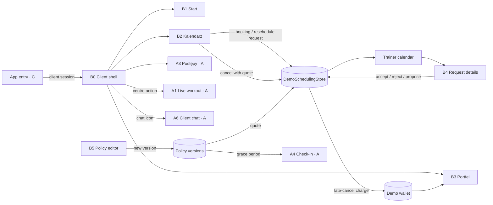

# Feature plan: client shell, sessions, wallet, request details and cancellation policy (Person B)

Status: v0.2, decisions D1–D10 agreed · 2026-11-05 · branch `client-shell-sessions-wallet` · roles: **client** and **trainer**

Person B builds the client app shell and five views. In this phase they are **views only**: they run on demo data, with no backend, payment provider or calendar sync. Every server touchpoint (booking, fee quote, payment confirmation, policy versioning) stays behind a repository interface and is simulated by a demo "server" with a fixed clock.

| # | View | Role | Stitch reference |
|---|---|---|---|
| B0 | Client shell: top bar, bottom navigation, role switch | Client | Bottom bar in [01](client-shell-sessions-wallet/reference/01-start-klient.jpg), [02](client-shell-sessions-wallet/reference/02-kalendarz-klient.jpg), [04](client-shell-sessions-wallet/reference/04-portfel.jpg) |
| B1 | Start – klient (client home) | Client | [01-start-klient.jpg](client-shell-sessions-wallet/reference/01-start-klient.jpg) |
| B2 | Kalendarz – klient, with session details, cancellation, reschedule and booking requests | Client | [02-kalendarz-klient.jpg](client-shell-sessions-wallet/reference/02-kalendarz-klient.jpg), [03-szczegoly-sesji.jpg](client-shell-sessions-wallet/reference/03-szczegoly-sesji.jpg) |
| B3 | Portfel (wallet) | Client | [04-portfel.jpg](client-shell-sessions-wallet/reference/04-portfel.jpg) |
| B4 | Szczegóły prośby (request details) | Trainer | [05-szczegoly-prosby.jpg](client-shell-sessions-wallet/reference/05-szczegoly-prosby.jpg) |
| B5 | Polityka odwołań (cancellation policy editor) | Trainer | [06-polityka-odwolan.jpg](client-shell-sessions-wallet/reference/06-polityka-odwolan.jpg) |

Context-only reference: [07-kalendarz-trener.jpg](client-shell-sessions-wallet/reference/07-kalendarz-trener.jpg) shows where the trainer meets requests ("Do potwierdzenia", "Zmiana terminu").

It follows [CLAUDE.md](../../CLAUDE.md) and [initial-architecture.md](../initial-architecture.md), sections 2 (G5, G7, G10–G13, G15), 3, 7, 8 and 10.5. As [context.md](../context.md) says, Stitch gives the direction and style, not a 1:1 spec: we keep the minimal version of each screen. The Stitch request-details mockup uses a dark theme; we build it in the shared light theme.

---

## 1. What already exists and will be reused

| Need | Existing code |
|---|---|
| Theme, components, bottom navigation | `shared/designsystem` (`AppBottomNavigation`, `TopLevelHeader`, `DetailHeader`, `CardRow`, `StatusChip`, `SegmentedTabs`, `AppBottomSheet`, `PrimaryButton`, `States.kt`) |
| Sessions, statuses, reschedule proposals, revisions, conflicts | `shared/src/.../pl/trainer/domain/Models.kt` (`Session`, `SessionStatus`, `RescheduleProposal`, `ProposalAuthor`, `TrainerRepository`, `Failure.Conflict`) |
| Trainer accept / reject / propose a time | `SessionDetailScreen` and `SessionEditorScreen` in `shared/src/.../pl/trainer/ui`, `TrainerViewModel.accept/reject/proposeTime`, tests in `TrainerBehaviorTest` |
| Trainer cancellation (no fee) | `TrainerRepository.cancelSession` |
| Current policy display | Read-only `PolicyCard` in `androidApp/.../trainerprofile/TrainerProfileScreen.kt:408` |
| Money formatting | `androidApp/.../core/format/MoneyFormat.kt` (`Pln`, Android only) |

**On other branches, not yet in `main`. Person B's work plugs into them:**

| Branch | What B uses |
|---|---|
| `origin/guest` (Person C) | `Role`, `AuthSession(roles, activeRole)`, `AuthRepository`; `App.kt` `startDestinationFor`, which sends a client to `ClientHomeDestination`; `ClientHomePlaceholder` (B0 replaces it); `GuestIntent.RequestSession(trainerId, gymId)`, which a signed-in guest carries into the client shell; `shared/domain/.../format/Money.kt` (`Money(minor, currency)`) |
| `origin/workout-logging-video` (Person A) | Live workout (A1), summary (A2), `ProgressRoute` as tab content (A3), `ClientChatRoute` (A6, Android only); `ClientPreviewScreen` (B0 replaces it); `Session.planTitle` and `Session.payment` (`SessionPayment`, `PaymentKind`) |

**Merge order:** C's and A's branches should be merged into `main` before slice 2 (§7). Slice 1 depends only on `main` and can start now.

What does **not** exist yet: client sessions, booking requests from the client, the client's own cancellation, fee quotes, cancellation policy versions, packages, charges, payments and invoices.

---

## 2. Where the code goes

| Part | Location | Why |
|---|---|---|
| B0–B3 | New KMP module `shared/feature/client` (same layout as `workout-builder` and `guest`) | Client views; iOS-ready |
| Policy rules and fee calculation | `:contract`, package `policy` (`CancellationPolicy`, `PolicyTier`, `FeeCalculator`) | Architecture 3.2: one calculation, shared by the app preview and the server charge |
| Client scheduling and wallet domain | `shared/domain/.../client` (`ClientSession`, `CancellationQuote`, `Charge`, `Payment`, `SessionPackage`) and repository interfaces | Pure Kotlin, testable |
| Shared demo "server" for sessions | `shared/src/.../pl/trainer/data/DemoSchedulingStore.kt` | One store behind the trainer's `TrainerRepository` and the client's `ClientScheduleRepository`, so a request sent by the client appears in the trainer calendar (§4) |
| B4 | `shared/src/.../pl/trainer/ui/RequestDetailScreen.kt` | Next to `SessionDetailScreen`, with the same view model and repository |
| B5 | `androidApp/.../feature/trainerprofile/CancellationPolicyScreen.kt`, opened as `TrainerRoute.CancellationPolicy` | The policy card and the profile live there today |

---

## 3. Screens

Each screen has loading, content, empty and recoverable error states unless a row says otherwise. All text goes to string resources. Dates, times and money use the shared locale-aware formatters; money is always `Money(minor, currency)`, never a floating-point value.

### B0 Client shell

**Purpose:** the one frame around every client view. It owns the top bar, bottom navigation, snackbars and the stack of pushed screens; feature screens render only their content.

| Stitch element | Decision |
|---|---|
| Tabs Start / Kalendarz / LIVE / Postępy / Portfel | **Keep four tabs:** Start, Kalendarz, Postępy, Portfel. **Change** the centre "LIVE" button into an action, like the trainer's "+": it opens A1, resuming a workout in progress or starting today's plan (**D3**). |
| Top bar: title, bell, avatar | **Keep** the title and avatar. The avatar opens a short menu: "Przełącz na trenera" (only when the session has both roles), "Wyloguj". **Drop** the bell until client notifications exist (**D4**). |
| Chat icon with unread count (Start header) | **Keep** in the top bar on every tab. It opens A6 through a slot provided by the Android host, because A6 is Android only. |

Entry: `App.kt` routes `ClientHomeDestination` to the client shell instead of `ClientHomePlaceholder`. A pending `GuestIntent.RequestSession` opens the booking request sheet (B2) with the trainer filled in; it never sends a request by itself. Switching roles replaces the back stack with the other role's shell.

### B1 Start – klient (client home)

**Purpose:** what matters today: the next session, today's workout and anything that needs the client. **Entry:** Start tab.

| Stitch element | Decision |
|---|---|
| "Hej, Kasia" header with QR button | **Keep** the greeting, small. **Drop** the QR button. |
| "Najbliższa sesja" card: status, time, plan, trainer, place, "Zmień termin", "Napisz" | **Keep.** "Zmień termin" opens the reschedule request (B2); "Napisz" opens A6. "Szczegóły" opens the session details. |
| "Dzisiejszy trening" with photo, "Rozpocznij" | **Keep without the large photo:** plan day name, exercise count and "Rozpocznij" (or "Wróć do treningu") opening A1. **Drop** the kcal and RPE badges. |
| "Twoje postępy": package, record, body weight | **Keep only the package line** ("Pakiet: 5 z 8 sesji"), linking to Portfel. Progress belongs to A3. |
| **Add:** "Wymaga uwagi" | The trainer's reschedule proposal awaiting an answer, an unpaid charge, a booking request that was rejected or expired. Hidden when empty. |
| "Odkryj trenerów", hydration tip | **Drop.** |

States: no trainer yet (empty state with "Znajdź trenera", opening the guest trainer list from C), no upcoming session, no plan for today, offline (cached data with a "Brak połączenia" line).

### B2 Kalendarz – klient, session details and requests

**Purpose:** the client's sessions and requests, and the actions on them. **Entry:** Kalendarz tab, B1 cards, notifications later.

**Calendar tab:**

| Stitch element | Decision |
|---|---|
| Week strip with day dots | **Keep.** Tapping a day scrolls the agenda. |
| Tydzień / Miesiąc switch | **Drop** the month view for now (**D5**). |
| Session cards with status chips | **Keep:** `Potwierdzona`, `Czeka na trenera` (booking request), `Propozycja zmiany` (reschedule in negotiation; the original time is still the confirmed one), `Odrzucona`, `Wygasła`, `Odwołana`, `Zakończona`. Status always has a label and an icon. |
| "Zrób Check-in" on today's session | **Drop:** check-in is the trainer's action (A4). |
| Trainer's proposal with ✕ / "Akceptuj" | **Keep.** "Akceptuj" uses the primary button style, not a green one. The session moves only after the demo server accepts it. |
| "Odwołaj rezerwację" on a pending request | **Keep** as "Wycofaj prośbę": withdrawing a request costs nothing. |
| "Edytuj notatkę", "Filtruj" | **Drop.** |
| "Dodaj do Kalendarza Google" | **Move** to the session details as a secondary action (Android insert intent, G5, **D6**). Hidden on desktop. |
| "Pakiety i karnety" card | **Keep, small**, linking to Portfel. |
| **Add:** "Poproś o sesję" | The tab's one primary action. It opens the booking request sheet. |

**Session details (pushed screen):** time and time zone, place, trainer, plan, status and how it is paid (`SessionPayment`, read-only). Actions depend on the status: "Zmień termin" and "Odwołaj sesję" for a confirmed session, "Wycofaj prośbę" for a request, an answer to a trainer's proposal. "Napisz do trenera" opens A6.

**Cancellation sheet** ([03-szczegoly-sesji.jpg](client-shell-sessions-wallet/reference/03-szczegoly-sesji.jpg)):

| Stitch element | Decision |
|---|---|
| "Późna rezygnacja · Odwołanie teraz kosztuje 50% (60 zł)" | **Keep.** The amount comes from a fresh **server quote** for the session's revision, never from a calculation on the device clock. |
| Quote countdown "04:57" | **Keep:** the quote's expiry. When it expires or the session changes, the sheet asks for a fresh quote before confirming. |
| "Kwota zostanie pobrana z podpiętej karty" | **Change** by how the session is paid: online → "Pobierzemy 60 zł osobną płatnością"; cash → "60 zł doliczymy do następnej sesji"; package → "Wykorzystamy 50% wejścia z pakietu". |
| "Masz 0 bezpłatnych odwołań w tym miesiącu" | **Keep.** When a free late cancellation is used, the quote shows 0 zł and says so. |
| "Zasady odwołań trenera Michała" | **Keep:** opens the policy version the client accepted at booking, read-only. |
| "Odwołaj sesję (60 zł)" / "Wróć do szczegółów sesji" | **Keep.** Destructive style; the label names the amount, or "Odwołaj sesję (bez opłaty)". Disabled while submitting. Offline: "Niewysłane". It is never shown as cancelled before the server confirms. |

**Reschedule request sheet:** pick a free slot from the trainer's demo availability. A late reschedule shows the fee the policy **proposes**, with "O opłacie zdecyduje trener" (architecture 3.2). Sending creates a proposal; the original session stays confirmed.

**Booking request sheet:** trainer (pre-filled from `GuestIntent` or the current trainer), day, free slot, place. Before sending, the client ticks the trainer's current policy (not pre-ticked, architecture 3.2). Sending creates a `Requested` session: "Prośba wysłana · czeka na trenera".

### B3 Portfel (wallet)

**Purpose:** what the client owes, what they have, and what they paid. **Entry:** Portfel tab, B1 and B2 package links, an unpaid charge in B1.

| Stitch element | Decision |
|---|---|
| Package card "Pakiet 8 sesji / mies. · 5/8 · Odnowienie 1.11" | **Keep:** package name, used and total sessions, trainer, and the validity date **as given by the data**. No renewal, expiry or rollover logic (G13 is unresolved). |
| "Do zapłaty: opłata za późne odwołanie 60 zł" with "Zapłać 60 zł" | **Keep.** Online charges get "Zapłać 60 zł", which opens the payment sheet. Cash charges show "Zapłacisz trenerowi przy następnej sesji", with no button. |
| Payment sheet (not in Stitch) | **Add:** amount, reason, method (card, BLIK, Przelewy24, demo test mode), "Zapłać 60 zł". After submitting: "Płatność w toku · czekamy na potwierdzenie", until the demo server confirms. A success callback is never shown as paid. |
| "Metody płatności" with "Dodaj nową" | **Drop:** methods are chosen in the payment sheet. Saving cards belongs to the payment provider integration. |
| "Historia płatności" with status and PDF | **Keep** the list with statuses `Opłacone`, `W toku`, `Nieudane`, `Zwrócone`. **Drop** the PDF download until invoices exist (**D2**). |
| "Kup pakiet" (twice) and SSL text | **Drop** (**D1**). |

States: nothing to pay (the charge card is hidden), no package ("Rozliczasz się za pojedyncze sesje"), offline (cached, payment disabled with "Płatność wymaga połączenia").

### B4 Szczegóły prośby (request details, trainer)

**Purpose:** the trainer decides on a booking or reschedule request with everything in one place. **Entry:** "Do potwierdzenia" and "Zmiana terminu" cards in the trainer calendar, trainer home attention items, a request notification. Confirmed sessions keep using `SessionDetailScreen`.

| Stitch element | Decision |
|---|---|
| Client name, "Pakiet 4/8", "Zgłoszono 20 min temu" | **Keep.** Drop the online dot. |
| Current time → proposed time, "Dostępny slot w grafiku" | **Keep.** The current time is labelled "Obecny termin (nadal potwierdzony)", never "Anulowany". Availability comes from the demo server; a conflict shows "Termin zajęty" and disables "Akceptuj". |
| "Zasady odwołań i zmiany terminu: Późna zmiana: 50% (60 zł)" | **Keep** for late reschedules only, with the policy version the client accepted. |
| "Odpuść opłatę" switch | **Keep** (architecture 3.2, waiver): full waiver in this phase, with an optional reason. No partial waivers (**D8**). |
| "Akceptuj" / "Zaproponuj inny termin" / "Odrzuć" | **Keep.** "Akceptuj" is the one primary action. "Zaproponuj inny termin" reuses `SessionEditorScreen`. "Odrzuć" asks for confirmation. A stale revision shows the existing conflict dialog. |

### B5 Polityka odwołań (cancellation policy editor, trainer)

**Purpose:** the trainer sets their cancellation rules; saving creates a new version. **Entry:** "Polityka odwołań" card in the trainer profile, which becomes a summary of the current version.

| Stitch element | Decision |
|---|---|
| Presets Elastyczna / Standardowa / Restrykcyjna, "Własna konfiguracja" | **Keep** the three presets (values in **D7**). Changing any value switches to "Własna". |
| Tiers: free until N h, middle tier with hours and %, late tier % | **Keep** as labelled steppers and percentage chips (0, 25, 50, 75, 100), not free sliders. The amount next to each % uses the trainer's demo rate. |
| No-show % and grace period (5–30 min) | **Keep.** The grace period is the value A4 check-in uses (A's D2). |
| "Wyrozumiałość trenerska": free late cancellations per month | **Keep.** |
| "Wpływ na konwersję" statistics | **Drop:** fabricated metrics. |
| **Add:** legal warning | For aggressive settings (a 100% fee earlier than 24 h, or 100% with no free late cancellations) show the warning from architecture 3.2. It is a warning, not a block. |
| "Podgląd z perspektywy klienta" | **Keep:** the exact text the client sees in B2 when booking. |
| "Zapisz nową wersję" · "Nowe reguły będą obowiązywać dla sesji rezerwowanych od jutra" | **Keep** the button. **Change** the note: "Dotyczy rezerwacji złożonych po zapisaniu. Istniejące sesje zachowują swoją wersję." Show the current version number and date. Back with unsaved changes asks to discard. |

---

## 4. How the views work together

**One demo "server" per concept, shared by both roles:**

- **Sessions and requests:** one `DemoSchedulingStore` with a fixed demo clock. The trainer's `TrainerRepository` and the client's `ClientScheduleRepository` both read and write it, with revisions and conflicts as today. A client's booking request appears in the trainer calendar; the trainer's answer appears in the client calendar. This is also the "one demo session source" in A's open question Q8 (**D10**).
- **Policies:** `DemoPolicyRepository` keeps the trainer's versions. Each session stores the version accepted at booking; quotes and A4's grace period use that version.
- **Money:** a late cancellation creates a `Charge` in the demo wallet according to how the session is paid; paying it moves through `W toku` to `Opłacone` after a short delay.

---

## 5. Shared changes (affect other views: announce before merging)

| Change | Affects | Compatibility |
|---|---|---|
| `SessionStatus` gains `CancelledByClient` and `Expired` (architecture 7.1) | Calendar status chips and filters (`Components.kt`), A's check-in, `TrainerBehaviorTest` | Additive; every `when` over the enum must handle them |
| `Session` gains `policyVersionId` and `price: Money` | Calendar demo data, A's check-in | Defaults keep existing fixtures working |
| `DemoTrainerRepository` reads and writes `DemoSchedulingStore` | Calendar, trainer home, A's check-in | Same interface; fixtures move into the store |
| New `:contract` package `policy` with `FeeCalculator` | None yet | New |
| `Money` moves from `shared/domain` (C's branch) to `:contract`, so the fee calculation can use it | C's guest views and formatters | Type alias left in `shared/domain` for one release |
| `App.kt`: `ClientHomeDestination` → client shell; `ClientHomePlaceholder` and A's `ClientPreviewScreen` removed | C's and A's entry points | Coordinate with C and A |
| Client items in `AppBottomNavigation` and the centre action | Trainer navigation (C also edited `BottomNavigation.kt`) | One component, two item sets |
| `TrainerRoute.CancellationPolicy` and `TrainerRoute.RequestDetail`; the profile `PolicyCard` shows the current version | `AppShell.kt` (A edits it too), trainer profile | Small edits, merge often |

---

## 6. Domain (local only)

- `CancellationPolicy(versionId, version, createdAt, tiers: List<PolicyTier(hoursBefore, feePercent)>, noShowPercent, graceMinutes, freeLateCancellationsPerMonth)`. Versions are immutable.
- `FeeCalculator.quote(policy, sessionStart, receivedAt, price, freeLeft, cancelledBy)` returns the tier, percent, amount in minor units and whether a free cancellation is used. A trainer's cancellation is always 0. The time used is the **server receipt time**, never the device clock.
- `CancellationQuote(sessionId, revision, amount: Money, percent, usesFreeCancellation, expiresAt)`.
- `ClientSession` is the client's view of `Session`: trainer name, place, plan title, status, proposal, payment, policy version.
- `BookingRequest(trainerId, start, end, place, acceptedPolicyVersionId)`; `RescheduleRequest(sessionId, revision, start, end)`.
- `SessionPackage(name, used, total, validUntil?)`, `Charge(id, reason, sessionId, amount, kind: Online | Cash | PackageCredit, state)`, `Payment(id, amount, method, state: Pending | Paid | Failed | Refunded, at)`.
- Demo availability: fixed working hours per trainer (Mon–Fri 7:00–20:00, **D9**), minus sessions and blocks from the store.

---

## 7. Delivery slices

Each slice ends with a buildable app, previews and its tests.

1. **Foundations (needs only `main`):** `:contract` policy and `FeeCalculator`; the new `SessionStatus` values; `DemoSchedulingStore` behind `DemoTrainerRepository` with the calendar tests still passing; the empty `shared/feature/client` module.
2. **B0 client shell** (after A's and C's branches are merged): navigation, top bar, role switch, A1/A3/A6 wired in, `GuestIntent` handed to B2, placeholders removed.
3. **B1 Start.**
4. **B2 calendar and session details:** agenda, statuses, answering the trainer's proposal, withdrawing a request.
5. **B2 requests and cancellation:** booking request sheet with policy consent, reschedule request, cancellation sheet with quote and expiry.
6. **B4 request details:** the screen, waiver, conflict state, routes from calendar and trainer home.
7. **B5 policy editor:** presets, tiers, warning, client preview, versioning, profile summary.
8. **B3 wallet:** package, charges, payment sheet with pending → paid, history.
9. **Polish and handoff:** large fonts, small screens, TalkBack labels, long Polish names, screenshots in `docs/previews`.

B4 and B5 depend only on slice 1, so they can be built before the shell if A's and C's branches are not merged yet.

---

## 8. Decisions

Agreed on 2026-11-05:

| # | Decision |
|---|---|
| D1 | The client cannot buy a package in this phase ("Kup pakiet" is not built). Renewal, expiry and rollover (G13) stay unresolved. |
| D2 | No invoice PDF download until invoices exist. The history shows payments only. |
| D3 | The centre "LIVE" button is an action, like the trainer's "+": it opens or resumes A1. It is not a tab. |
| D4 | No notifications bell in the client shell until client notifications are planned. |
| D5 | The client calendar has a week strip and an agenda; no month view. |
| D6 | "Dodaj do kalendarza" (G5) is an Android insert intent from the session details. No webcal feed yet. |
| D7 | Presets. Elastyczna: free until 12 h, 50% under 12 h. Standardowa: free until 24 h, 50% 12–24 h, 100% under 12 h. Restrykcyjna: free until 48 h, 50% 24–48 h, 100% under 24 h. All three: no-show 100%, grace period 15 min, 1 free late cancellation per month. |
| D8 | Fee waivers are full only, with an optional reason. No partial waivers in this phase. |
| D9 | Demo availability for requests: fixed working hours Mon–Fri 7:00–20:00, minus sessions and blocks. |
| D10 | One shared demo session store, `DemoSchedulingStore`, for the trainer calendar, trainer home, check-in and the client. This also closes A's open question Q8. |

No open questions remain for Person B.

---

## 9. Tests that matter

- **Fee calculator:** each tier, exact boundaries (24 h and 12 h before), receipt time vs answer time, free late cancellations, no-show, trainer cancellation always 0, amounts in minor units without rounding errors.
- **Policy versions:** saving creates a new version; existing sessions keep theirs; the aggressive-settings warning appears and does not block saving.
- **Scheduling store (both roles):** a client booking request appears in the trainer calendar as `Requested`; accepting it confirms it for the client; a reschedule moves the session only after acceptance; rejecting keeps the original; a stale revision gives a conflict; withdrawing a request costs nothing.
- **Cancellation:** an expired quote or a changed revision forces a fresh quote; a double tap cancels once; offline shows "Niewysłane" and changes nothing; the charge matches how the session is paid.
- **Wallet:** paying moves `W toku` → `Opłacone` only after the demo confirmation; a double tap pays once; cash charges have no pay button.
- **Shell:** the role switch appears only with both roles and replaces the stack; a pending `GuestIntent` opens the booking sheet and never sends a request by itself.
- **Request details:** the waiver removes the fee from the resulting charge; a slot conflict disables "Akceptuj".
