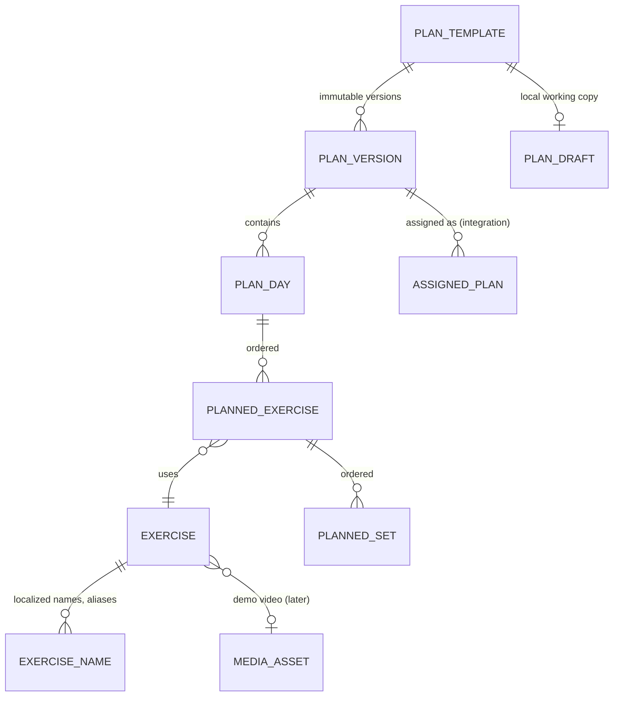

# Feature plan: plan creator and exercise library

Status: draft v0.1 · 2026-10-28 · branch `workout-plan`

This document plans two related features:

- the **exercise library**, a database of predefined exercises plus a trainer's own exercises, and
- the **plan creator**, where a trainer builds a workout plan from those exercises.

It follows [CLAUDE.md](../../CLAUDE.md) and [initial-architecture.md](../initial-architecture.md), sections 5, 6, 9.1 and 10.4. Items marked **Decision** need the team's agreement before the slice that depends on them starts.

---

## 1. Inputs and current state

| Input | State |
|---|---|
| Repository | Documentation only. There is no KMP project, shared theme, app shell, navigation, backend or build yet. |
| Stitch design | **Not pulled yet.** `stitch.google.com` is blocked by this cloud environment's network policy, and Stitch projects need a Google sign-in anyway. Section 4 is built from the visual baseline in CLAUDE.md. It must be checked against the Stitch screens before UI work starts (see section 10). |
| Exercise data | `free-exercise-db` (yuhonas/free-exercise-db), public domain (Unlicense). Checked 2026-10-28: **876 exercises**, 873 of them with two JPG images (start and end position). |

### What `free-exercise-db` contains

Each record has `id`, `name`, `category`, `equipment`, `level`, `mechanic`, `force`, `primaryMuscles`, `secondaryMuscles`, `instructions[]` and `images[]`.

- **Categories:** strength 584, stretching 123, plyometrics 61, powerlifting 38, olympic weightlifting 35, strongman 21, cardio 14.
- **Equipment:** barbell 170, dumbbell 123, other 122, body only 111, cable 81, *none* 77, machine 67, kettlebells 56, bands 20, medicine ball 17, exercise ball 12, foam roll 11, e-z curl bar 9.
- **Muscles (17):** abdominals, abductors, adductors, biceps, calves, chest, forearms, glutes, hamstrings, lats, lower back, middle back, neck, quadriceps, shoulders, traps, triceps.

Gaps we have to fill:

1. **English only.** The app targets Polish and English.
2. **Near-duplicates and niche variants**, for example "Barbell Squat" vs "Barbell Full Squat", or "Bench Press with Chains". Showing all 876 makes search noisy.
3. **No tracking type.** The logger needs to know whether an exercise takes weight × reps, reps only, time or distance.
4. **Stock images only.** The architecture prefers videos recorded by the trainer. The dataset images are a fallback.

---

## 2. Scope

### In scope

- A global exercise library seeded from `free-exercise-db`, with Polish and English names.
- Browse, search and filter by muscle group and equipment, plus an exercise detail view.
- Trainer-owned custom exercises.
- A plan library: the trainer's list of plan templates.
- The plan creator: create and edit a template made of workout days, exercises and planned sets. Drafts are saved locally.
- Publishing an immutable plan version.

### Integration points to preserve, not build here

- **Assign a plan version to a client** (`AssignedPlan`). The client's "today's plan" and the workout logger read it.
- **Trainer demo video** on an exercise, through the shared media pipeline (section 9.3 of the architecture).
- Pinning a plan to a session.

### Out of scope

- Nutrition, calorie estimates, ratings, and AI plan generation, even if Stitch shows them.
- %1RM-based loading and periodisation blocks. These may come later.
- Plans as a separately sold digital product. Plans are included in coaching; architecture section 4 explains why.

---

## 3. Domain model

This extends architecture section 10.4. The one structural change is **`PlanDay`**. The ER diagram links `PLAN_VERSION` straight to `PLANNED_EXERCISE`, but a trainer's plan is normally several workouts ("Day A / Day B", "Push / Pull / Legs").



### Exercise

| Field | Notes |
|---|---|
| `id` | Our UUID. Never expose the source's id as the primary key. |
| `ownerTrainerId` | `null` = global library; otherwise the trainer's own exercise, visible only to that trainer. |
| `source`, `sourceId` | e.g. `free-exercise-db` / `Barbell_Squat`. Used for re-imports and attribution. |
| `names` | Per locale (`pl`, `en`), plus search aliases such as "bench", "wyciskanie leżąc" and "klata". |
| `primaryMuscles`, `secondaryMuscles` | A shared `MuscleGroup` enum in `:contract`, starting with the 17 dataset values. |
| `equipment` | A shared `Equipment` enum. The dataset's *none* maps to `OTHER`, after a manual check. |
| `trackingType` | `WEIGHT_REPS`, `REPS`, `TIME`, `DISTANCE_TIME`. Derived from the category during import, then corrected by hand for the curated set. The logger depends on it. |
| `category`, `mechanic`, `level` | Kept for filtering and future use; not shown by default. |
| `instructions` | Per locale. English comes from the dataset; Polish is added for the curated set. |
| `images`, `demoMediaId` | Dataset images are copied to our storage, not hotlinked. `demoMediaId` is the trainer video integration point. |
| `status` | `ACTIVE` / `HIDDEN`. Hidden records stay because historical plans and logs reference them. Exercises are never hard-deleted. |
| `updatedAt` | Drives incremental sync to the app. |

### Plan

| Entity | Fields | Rules |
|---|---|---|
| `PlanTemplate` | `id`, `ownerTrainerId`, `name`, `description?`, `latestVersion`, `archivedAt?` | Owned by one trainer. |
| `PlanVersion` | `id`, `templateId`, `number`, `createdAt`, `basedOnVersion` | **Immutable.** `(templateId, number)` is unique. Saving creates a new version. Old assignments keep their version. |
| `PlanDay` | `id`, `versionId`, `position`, `name` | e.g. "Day A – Upper". |
| `PlannedExercise` | `id`, `dayId`, `position`, `exerciseId`, `supersetGroup?`, `note?`, `restSeconds?` | The note is the trainer's cue for that exercise in this plan. |
| `PlannedSet` | `id`, `plannedExerciseId`, `position`, `type` (warm-up / working / drop), `repsMin?`, `repsMax?`, `weight?` + `unit`, `durationSeconds?`, `distanceMeters?`, `rpe?`, `rir?`, `tempo?`, `restSeconds?` | The fields that apply depend on `trackingType`. A reps range is `repsMin..repsMax`; a fixed rep count has min = max. |
| `PlanDraft` (local only) | The whole editable tree plus `baseVersion` | Autosaved to SQLDelight on every change and survives process death. Deleted on successful publish. |

Notes:

- Weight is stored as an integer in grams together with its display unit, to avoid floating-point drift in the same way as money. **Decision D6.**
- Validation (`PlanValidator`) lives in `:contract`, so the app and the server reject the same inputs. A plan needs a name, at least one day, and at least one exercise per day. Reps must satisfy 1 ≤ min ≤ max ≤ 100. RPE must be 1–10 in 0.5 steps. Only one of RPE and RIR may be set.

---

## 4. Screens (trainer role)

The layout follows CLAUDE.md sections 3–6: one purpose per screen, one dominant action, flat surfaces, a 20 dp gutter, 16 dp card radius and IBM Plex Sans. **To be checked against Stitch.**

| # | Screen | Purpose | Primary action | Key states |
|---|---|---|---|---|
| S1 | **Plan library** | The trainer's plan templates: name, number of days, last edited, number of clients using them later. | "New plan" | loading, empty ("Create your first plan"), error + retry, offline (cached list, read-only badge), unpublished-draft badge per row |
| S2 | **Plan editor** | Edit name and days; reorder, add and remove exercises; edit sets inline. | "Save" (publishes a version) | draft autosaved, saving, saved as version N, validation errors inline, offline ("Draft saved on this device – publish when online"), conflict (another device published version N+1) |
| S3 | **Exercise picker** (full screen) | Search and multi-select exercises to add to a day. | "Add (3)" | loading, no results + "Create custom exercise", offline (works from local cache) |
| S4 | **Exercise detail** | Images or demo video, muscles, equipment, instructions. | none in the library; "Add to day" when opened from the picker | media placeholder; video upload states once video is in scope |
| S5 | **Custom exercise form** | A trainer creates their own exercise: name, primary muscle, equipment, tracking type, optional instructions. | "Create exercise" | validation, submitting, duplicate-name warning (soft, not a block) |
| S6 | **Set details sheet** | Advanced fields for one exercise: set types, RPE/RIR, tempo, rest, note. | "Done" | |

### Plan editor layout (S2)

- **Top app bar:** back, plan name (tap to rename), overflow menu (duplicate, archive). Back with unsaved changes keeps the draft and needs no dialog, because the draft is already saved locally.
- **Day selector:** pill chips "Day A · Day B · +". Long-press a chip, or use its menu, to rename, duplicate or delete the day.
- **Exercise list** for the selected day. Each row shows the thumbnail, name and a compact set table:

  ```
  [img] Barbell Squat                         ⋮
        SET   REPS    KG     REST
        1     8–10    60     2:00
        2     8–10    60     2:00
        + Add set
  ```

  - The fields shown match the exercise's tracking type, with numeric keyboards. Editing a set copies its values to the next new set, as in Hevy.
  - The row menu holds reorder, superset with next, set details (S6) and remove.
- **Bottom of the list:** "Add exercises" (secondary) opens S3. The fixed primary "Save" button sits above the keyboard and system bars, and the list scrolls clear of it.

### Exercise picker (S3)

- A search field at the top. Search is local and accent-insensitive across both locales' names and aliases, so "wyciskanie", "wyciskanie lezac" and "bench" all match.
- One row of filter chips: muscle group and equipment. Each opens a short sheet.
- Sections when there is no query: "Recently used", then "My exercises", then A–Z.
- Rows show a thumbnail, the name and the primary muscle, with a checkbox. Tapping the thumbnail opens S4.
- The selection count is shown in the primary button. Exercises are added in the order they were selected.

### Navigation (**Decision D1**)

The reference trainer tabs are Start / Calendar / Clients / Finance, so there is no obvious home for the plan library. Options:

- **A. Clients tab → "Plans" segment** (Clients | Plans). Recommended: plans exist to be assigned to clients.
- **B. A fifth top-level tab, "Plans".**
- **C. Start screen shortcut plus a profile menu entry.**

The exercise library opens from inside the plan area (S1 overflow → "Exercise library") and from the picker. It does not need a tab.

---

## 5. Behaviour rules

1. **Drafts are local and continuous.** Every edit goes to `PlanDraft` in SQLDelight immediately. The editor never loses input to process death, a failed save or going offline.
2. **Publishing creates a version.** "Save" sends the draft with `baseVersion` and a client-generated `operationId`.
   - The server returns the new version number. Retries with the same `operationId` return the same version, so a retry never publishes twice.
   - If `baseVersion` ≠ the server's latest version, the server returns a conflict. The UI then offers "Review latest" or "Save as new plan". There is no silent overwrite.
3. **Offline publishing (Decision D4):**
   - **Proposal:** publishing needs the server. While offline, the editor shows "Draft saved on this device". The Save button stays enabled and shows an inline "Not published – you're offline" message.
   - **Alternative:** queue the publish in the operation queue with a pending badge.
4. **Editing never rewrites history.** Clients on version N keep version N. After publishing N+1, the editor offers "Update for clients on version N" as a separate, explicit action. That action belongs to the assignment integration.
5. **Deleting an exercise** used in any plan or log only hides it (`HIDDEN`). Existing plans keep showing it with a "No longer in library" label.
6. **The exercise library works offline.** The full global library plus the trainer's own exercises sync to the device. The first sync is about 876 rows, then only `updatedSince` changes. Images load lazily and are cached by Coil.

---

## 6. Architecture

| Layer | Pieces |
|---|---|
| `:contract` | `ExerciseDto`, `PlanTemplateDto`, `PlanVersionDto` (nested days, exercises and sets), enums `MuscleGroup`, `Equipment`, `TrackingType`, `SetType`, and `PlanValidator`. |
| `shared/domain` | Models; use cases `SearchExercises`, `GetExercise`, `CreateCustomExercise`, `GetPlanLibrary`, `OpenPlanDraft`, `UpdatePlanDraft` (pure reducers for add, move, remove and superset), `PublishPlan`. |
| `shared/data` | `ExerciseRepository`: SQLDelight tables plus an FTS table over normalized names and aliases, and incremental sync. `PlanRepository`: templates, versions, local drafts and the publish call. |
| `shared/feature/workout-builder` | `PlanLibraryViewModel`, `PlanEditorViewModel`, `ExercisePickerViewModel`, `ExerciseDetailViewModel`, `CustomExerciseViewModel`. Each exposes an immutable state through `StateFlow` and takes explicit events. The screen content is previewable with fixtures. |
| Backend (Training module) | Tables `exercise`, `exercise_name`, `plan_template`, `plan_version`, `plan_day`, `planned_exercise`, `planned_set`, plus a unique `operation_id`. Endpoints, sketched below. |
| Seed import | A one-off, repeatable import job (backend `tools/` or a Gradle task). It reads `free-exercise-db` JSON, maps it to our enums, applies a **curation file** (keep/hide, Polish names, aliases, tracking-type overrides), copies images to object storage and upserts by `(source, sourceId)`. |

Endpoint sketch:

```
GET  /exercises?updatedSince=…        global + own
POST /exercises                        custom exercise
GET  /plans                            trainer's templates
GET  /plans/{id}/versions/{n}
POST /plans                            create template + version 1
POST /plans/{id}/versions              { baseVersion, operationId, body }
```

The server enforces that a trainer reads and writes only their own templates and custom exercises. Hiding a button in the UI is not authorization.

### Curation (Decision D3)

Proposal: ship the full dataset, but mark a curated set of about 150 common gym exercises as `featured`. The curated set gets Polish names, aliases, a checked tracking type and Polish instructions. Search ranks featured exercises first. The other ~720 keep English names until someone translates them. They can also be hidden if the team prefers a smaller library.

---

## 7. Delivery slices

Each slice is runnable and reviewable on its own.

| # | Slice | Depends on | Done when |
|---|---|---|---|
| 0 | **Foundations**: KMP project, shared theme tokens (CLAUDE.md section 4), app scaffold, trainer navigation, Koin, SQLDelight. | none | Owned by whoever starts first; coordinate so it is not built twice (**Decision D2**). |
| 1 | **Exercise library, read-only**, from a bundled fixture of the curated subset: S3 picker without multi-select, S4 detail, search and filters. | 0 | Search works offline, including Polish diacritics; loading, empty and error states are shown. |
| 2 | **Plan editor with local drafts**: S1, S2, S6 and S3 multi-select. Publishing goes to a fake repository. | 1 | A draft survives process death; validation works; reorder, superset and set-copy work. |
| 3 | **Backend and sync**: Training module tables, seed import with curation, the endpoints above, real repositories, version publishing, conflicts and idempotent retry. | 2, backend scaffold | Publishing creates immutable versions; a retry never duplicates; a stale `baseVersion` is a conflict. |
| 4 | **Custom exercises**: S5 and server ownership checks. | 3 | A trainer sees only their own custom exercises. |
| 5 | **Integration**: assign a version to a client (the client's plan and logger read it) and attach a trainer demo video. | 3, media pipeline, client relationships | Planned-vs-done reads the assigned version. |

---

## 8. Tests that matter

- **Draft reducers:** add, move, remove, superset grouping, and set-copy defaults.
- **`PlanValidator`:** the same cases run on the client and the server.
- **Draft persistence:** an edit, then process death, then reopening leaves an identical draft.
- **Publishing:**
  - A retry with the same `operationId` yields one version.
  - A stale `baseVersion` returns a conflict, and the draft is kept.
  - Publishing N+1 does not change N or its assignments.
- **Search:** accent-insensitive Polish and English matching; aliases; featured exercises ranked first.
- **Seed import:** idempotent upsert; enum mapping covers every dataset value; hidden exercises remain resolvable.
- **Authorization:** trainer A cannot read or edit trainer B's templates or custom exercises.

---

## 9. Decisions needed

| # | Question | Proposal |
|---|---|---|
| D1 | Where does the plan library live in trainer navigation? | A "Plans" segment inside the Clients tab. |
| D2 | Does this feature build the KMP scaffold and theme (slice 0), or is a teammate already doing it? | Coordinate. If nobody is on it, this branch does the minimum. |
| D3 | Library size and Polish content. | Full dataset, plus about 150 curated exercises with Polish names, aliases and instructions. |
| D4 | Can a plan be published while offline (queued)? | No. Drafts are local; publishing needs the server. |
| D5 | Can clients create their own plans or routines (Hevy-style), or only trainers? | Trainers only for now. Clients can still log independent workouts. |
| D6 | Weight unit: kg only, or kg/lb per user? | Store grams plus a display unit; kg by default. |
| D7 | Plan structure: multiple days per plan (`PlanDay`)? | Yes. This needs an update to the ER diagram in architecture section 10.4. |
| D8 | Are dataset stock images shown at all, or only trainer videos and placeholders? | Show them as thumbnails and in the detail view until a trainer video exists. |

## 10. Next step: the Stitch design

Before UI slices 1–2, export from Stitch the screens for the exercise list or search, the exercise detail and the plan or workout builder. Use Stitch's code/HTML export or screenshots, save them under `docs/design/stitch/plan-creator/`, and update section 4 with what we keep and what we simplify. Alternatively, allow `stitch.google.com` in the cloud environment's network settings. The project still needs a Google sign-in, so an export is the more reliable route.
