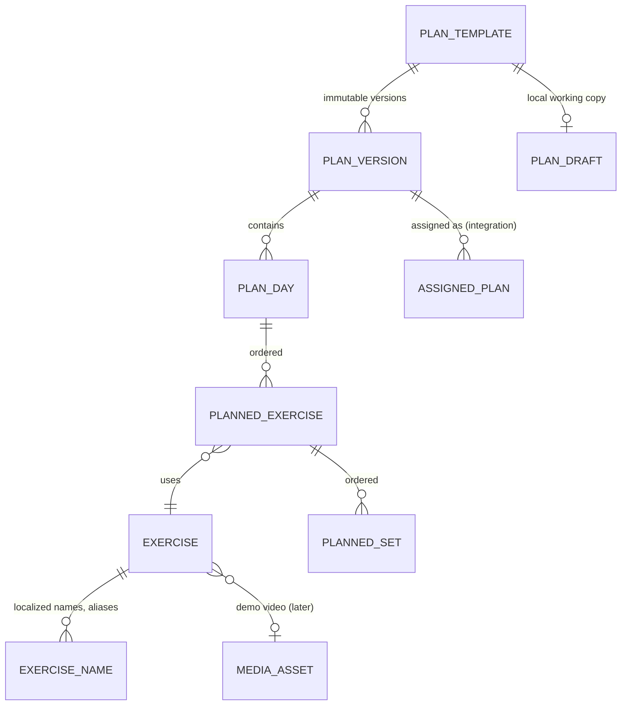

# Feature plan: plan creator and exercise library

Status: v0.3, decisions D1–D10 agreed · 2026-10-28 · branch `workout-plan` · role: **trainer**

This document plans two related trainer features:

- the **plan creator** ("Kreator planu"), where a trainer builds a workout plan, and
- the **exercise library**, which holds predefined exercises and lets the trainer **create their own exercises**.

It follows [CLAUDE.md](../../CLAUDE.md) and [initial-architecture.md](../initial-architecture.md), sections 5, 6, 9.1, 9.3 and 10.4. Items marked **Decision** refer to the agreed decisions in section 10.

---

## 1. Inputs and current state

| Input | State |
|---|---|
| Repository | Documentation only. There is no KMP project, shared theme, app shell, navigation, backend or build yet. Nothing in this plan exists as code. |
| Stitch design | Reviewed on 2026-10-28. The reference is the screen "Kreator planu" (`projects/10185753988111686080/screens/20cc25ddd7144b5c9d288cf4187f62dc`), saved as [kreator-planu.jpg](../design/stitch/plan-creator/kreator-planu.jpg). Stitch has **no** screens for the exercise library, exercise detail or exercise creation. Those screens reuse patterns from other Stitch screens, mapped in [design/stitch/reference](../design/stitch/reference/README.md). |
| Exercise data | `free-exercise-db` (yuhonas/free-exercise-db), public domain (Unlicense). It has 876 exercises, 873 of them with two JPG images. |

### What `free-exercise-db` contains

Each record has `id`, `name`, `category`, `equipment`, `level`, `mechanic`, `force`, `primaryMuscles`, `secondaryMuscles`, `instructions[]` and `images[]`.

- **Categories:** strength, stretching, plyometrics, powerlifting, olympic weightlifting, strongman, cardio.
- **Equipment:** barbell, dumbbell, cable, machine, kettlebells, bands, body only, and others.
- **Muscles:** 17 values, from abdominals to triceps.

Gaps we have to fill:

1. **Polish only.** The app targets Polish and English.
2. **Near-duplicates and niche variants**, which make search noisy.
3. **No tracking type.** The logger needs to know whether an exercise takes weight × reps, reps only, time, or distance and time.
4. **Stock images only.** Videos recorded by the trainer come later, through the media pipeline.

---

## 2. Scope

### In scope

- **Plan library:** the trainer's list of plan templates.
- **Plan creator:** create and edit a template made of workout days, exercises and planned sets. Drafts are saved locally all the time. Saving publishes an immutable plan version.
- **Exercise library:** browse, search and filter predefined and own exercises, plus an exercise detail view.
- **Exercise creation:** a trainer creates, edits and hides their own exercises.
- **Seed data:** a global library imported from `free-exercise-db`, with a curated subset in Polish.

### Integration points to preserve, not build here

- **Assign to client** ("Przypisz klientowi" in Stitch) creates an `AssignedPlan` that points to one version. The editor links to this flow after a successful save; the flow itself belongs to the clients/assignment feature.
- **Trainer demo video** on an exercise uses the shared media pipeline (architecture section 9.3). `Exercise.demoMediaId` is reserved for it.
- Pinning a plan to a session.

### Out of scope

- Plan tags, estimated duration, average RPE, calorie estimates, ratings, nutrition and AI generation, even where Stitch shows them.
- %1RM-based loading and periodisation blocks.
- Plans sold as a separate digital product.

---

## 3. Stitch review: what we keep, change and drop

The Stitch screen sets the direction. CLAUDE.md section 3 asks for a calmer, simpler version.

| Stitch element | Decision | Reason |
|---|---|---|
| Back arrow and title "Kreator Planu" | **Keep.** The title is "Nowy plan" or "Edytuj plan", depending on the mode. | Shared back-navigation pattern. |
| Chat, notifications and avatar in the top bar | **Drop.** Replace them with an overflow menu (duplicate, archive). | Detail screens do not repeat global controls (CLAUDE.md section 5). |
| Pulsing "Szkic autozapisu" badge and "Edytowano 2 min temu" | **Change** to one line of supporting text: "Szkic zapisany na urządzeniu". | The local-draft state matters; the badge and animation do not. |
| Pill-shaped name field with an icon and a tag button | **Change** to the shared text field with a persistent label "Nazwa planu". Tags are dropped. | Inputs need persistent labels; tags are not in scope. |
| Three stat tiles: total sets, estimated time, average RPE | **Drop.** Show "2 ćwiczenia · 6 serii" in the supporting line instead. | Estimated time needs policy and assumptions. The tiles push the content down. |
| Section "Kolejność ćwiczeń" with a count | **Keep**, as a plain section header. | |
| Exercise card: drag handle, thumbnail, muscle label, name | **Keep.** Add move up/down actions to the row menu as an accessible alternative to dragging. | |
| "Superseria" chip on a single card | **Change.** Linked exercises are grouped with a connector and the label "Superseria A". | A superset is a relation between two or more exercises, not a tag on one. |
| "Akcesoryjne" chip | **Drop.** | There is no domain field behind it. |
| Set table with 5 columns: set, weight, reps, RPE, rest | **Change.** The default columns are set, kg and reps. RPE appears only when it is enabled for that exercise. Rest is set once per exercise and shown under the name. | At 390 dp the Stitch inputs clip: "8powt." overlaps the value. Units move to the column headers. |
| "Dodaj serię", note, more menu | **Keep.** The note opens the exercise settings sheet. | |
| Orange full-width "Dodaj ćwiczenie z biblioteki" | **Change** to a secondary (outlined) button: "Dodaj ćwiczenia". | Stitch shows three primary-looking buttons on one screen. |
| Bottom bar "Zapisz szablon" + "Przypisz klientowi" | **Change** to one fixed primary button, "Zapisz plan". After a save, a snackbar shows "Zapisano wersję 3" with the action "Przypisz klientowi". | One dominant action. Assigning requires a published version anyway. |
| Corner arcs, glow, shadows, blur | **Drop.** | Flat surfaces (CLAUDE.md section 4). |
| A single workout, with no days | **Extend** with a day selector (**Decision D7**). | Trainers' plans are usually several workouts. |

---

## 4. Screens

All screens use the shared theme: 20 dp gutter, 16 dp radius for cards and inputs, IBM Plex Sans, named type styles and 48 dp touch targets. Copy comes from string resources in Polish and English. Numbers use the locale's format; Polish uses a decimal comma ("82,5").

| # | Screen | Purpose | Primary action | Key states |
|---|---|---|---|---|
| S1 | **Plan library** | The trainer's templates: name, number of days, last edited, and a draft badge. | "Nowy plan" | loading; empty ("Utwórz pierwszy plan"); error + retry; offline (cached list); unpublished-draft badge per row |
| S2 | **Plan editor** ("Kreator planu") | Edit the name and days; add, reorder and remove exercises; edit sets inline. | "Zapisz plan" (publishes a version) | draft saved locally; saving; saved as version N; inline validation; offline; conflict |
| S3 | **Exercise library / picker** | One screen with two modes: *browse* (from S1) and *pick* (from S2, with multi-select). | browse: "Nowe ćwiczenie"; pick: "Dodaj (3)" | loading; no results + "Utwórz „{query}”"; offline (works from the local cache) |
| S4 | **Exercise detail** | Images (later, the trainer's video), muscles, equipment, tracking type, instructions. | pick mode: "Dodaj do dnia"; own exercise: "Edytuj" | missing-media placeholder; "Ukryte" label |
| S5 | **Exercise form** (create or edit) | The trainer creates or edits their own exercise. | "Utwórz ćwiczenie" / "Zapisz zmiany" | validation; saving; pending sync; possible-duplicate warning; tracking type locked when the exercise is in use |
| S6 | **Exercise settings sheet** | Settings for one exercise in the plan: rest, RPE on/off, tempo, set types, note. | "Gotowe" | |

### S2 Plan editor

```
←  Nowy plan                                        ⋮
   Szkic zapisany na urządzeniu · 2 ćwiczenia · 6 serii

   Nazwa planu
   [ Hipertrofia Góra A – Faza 2                    ]

   (Dzień A) (Dzień B) ( + )

   Kolejność ćwiczeń
   ⠿ [img] Wyciskanie sztangi leżąc                 ⋮
           Klatka piersiowa · przerwa 2:00
       SERIA     KG       POWT.     RPE
       1        [80   ]  [8    ]   [8  ]
       2        [82,5 ]  [8    ]   [8,5]
       3        [85   ]  [6    ]   [9  ]
       + Dodaj serię

   ⠿ [img] Wiosłowanie hantlem w opadzie            ⋮
           Plecy · przerwa 1:30
       ...

   [ + Dodaj ćwiczenia ]                    (secondary)

 ──────────────────────────────────────────────────────
   [              Zapisz plan               ] (primary, fixed)
```

- **Top bar:** back, title, and an overflow menu (duplicate plan, archive). Going back with unsaved changes needs no dialog, because the draft is already saved on the device.
- **Days:** chips "Dzień A · Dzień B · +". The chip menu has rename, duplicate and delete. A new plan starts with one day.
- **Exercise row:**
  - It has a drag handle, a thumbnail, the name, and the primary muscle with the rest time.
  - The row menu has move up, move down, "Połącz w superserię z następnym", exercise settings (S6), replace exercise, and remove.
  - Removing an exercise shows a snackbar with "Cofnij" instead of a confirmation dialog.
- **Set table:**
  - Its columns follow the exercise's `trackingType`: `WEIGHT_REPS` → kg + reps; `REPS` → reps; `TIME` → time; `DISTANCE_TIME` → distance + time.
  - The RPE column appears only when RPE is enabled for that exercise.
  - Numeric keyboards are used everywhere. A reps range is entered as "8–10".
  - Tapping the set number cycles the set type: working "1", warm-up "W", drop set "D".
  - Swipe left, or the set menu, deletes a set.
  - "Dodaj serię" copies the values of the last set.
- **Layout:** the "Zapisz plan" button stays above the keyboard and system bars, and the list scrolls clear of it. While a save runs, the button shows a progress state and ignores taps.

### S3 Exercise library / picker

Visual reference: the Trenerzy, Klienci and Postępy screens. The element-by-element mapping is in [design/stitch/reference](../design/stitch/reference/README.md).

- **Search:** a search field at the top. Search is local and accent-insensitive across the Polish and English names and aliases, so "wyciskanie", "wyciskanie lezac" and "bench" all match.
- **Filters:** one row of chips, "Partia mięśniowa", "Sprzęt" and "Moje". Each opens a short sheet.
- **Sections without a query:** "Ostatnio używane" (pick mode), then "Moje ćwiczenia", then A–Z.
- **Rows:** thumbnail, name and primary muscle. In pick mode each row has a checkbox, and tapping the thumbnail opens S4.
- **Selection:** the primary button shows the selection count. Exercises are added to the current day in the order they were selected.
- **No results:** the screen shows "Brak wyników" plus the action "Utwórz „{query}”", which opens S5 with the name prefilled. In pick mode the created exercise is selected automatically.
- **Hidden exercises** do not appear in search.

### S5 Exercise form: creating an exercise

There is no Stitch reference for this screen; it uses the shared form components. It is a full screen, not a sheet, because it can hold long instructions.

```
×  Nowe ćwiczenie

   Nazwa *
   [ Hip thrust na maszynie                         ]
   Podobne: "Barbell Hip Thrust" – sprawdź      (soft warning)

   Główna partia mięśniowa *
   [ Pośladki                                     ▾ ]

   Sprzęt *
   [ Maszyna                                      ▾ ]

   Sposób zapisu *
   (Ciężar × powt.) (Powtórzenia) (Czas) (Dystans i czas)

   ▸ Więcej szczegółów
       Mięśnie pomocnicze   [ Dwugłowe uda, … ▾ ]
       Instrukcja           [                          ]
                            [                          ]

   [           Utwórz ćwiczenie            ]  (primary)
```

- **Required fields:** name (2–80 characters), primary muscle, equipment and tracking type. Tracking type defaults to "Ciężar × powt.".
- **Optional fields:** secondary muscles and instructions, inside "Więcej szczegółów".
- **Name language:** the name is stored in the trainer's current locale. The other locale falls back to the same text. There are no translation fields.
- **Duplicate check:** the normalized name is matched against the library. A match shows a soft warning with a link to the existing exercise; it never blocks saving.
- **Saving:** the exercise is saved locally with a client UUID and appears at once as "Oczekuje na synchronizację". Sync follows in the background (rule 7 in section 6).
- **Editing:**
  - Only the owner can edit their exercise.
  - Name, muscles, equipment and instructions can always be edited.
  - Tracking type is **locked** once any plan version or workout log uses the exercise. The field explains why.
- **Hiding:** the overflow menu on S4 has "Ukryj ćwiczenie". Hiding is reversible, and the exercise is never hard-deleted.
- **Demo video:** this is an integration point (`demoMediaId`). This feature shows no placeholder for it.

---

## 5. Domain model

This extends architecture section 10.4. The structural addition is **`PlanDay`** (**Decision D7**).



### Exercise

| Field | Notes |
|---|---|
| `id` | UUID. For custom exercises it is generated on the client, which makes creation idempotent. |
| `ownerTrainerId` | `null` = global library; otherwise a custom exercise visible only to its owner. |
| `source`, `sourceId` | e.g. `free-exercise-db` / `Barbell_Squat`; `trainer` for custom exercises. |
| `names` | Per locale (`pl`, `en`), plus search aliases. |
| `primaryMuscles`, `secondaryMuscles` | A shared `MuscleGroup` enum in `:contract`, with the 17 dataset values. |
| `equipment` | A shared `Equipment` enum. |
| `trackingType` | `WEIGHT_REPS`, `REPS`, `TIME`, `DISTANCE_TIME`. The logger depends on it. |
| `instructions` | Per locale, optional. |
| `images`, `demoMediaId` | Dataset images are copied to our storage, not hotlinked. `demoMediaId` is the video integration point. |
| `featured` | Marks the curated set, which ranks first in search. |
| `status` | `ACTIVE` / `HIDDEN`. Exercises are never hard-deleted, because plans and logs reference them. |
| `inUse` (derived) | True once a plan version or workout log references the exercise. It locks `trackingType`. |
| `updatedAt` | Drives incremental sync. |

### Plan

| Entity | Fields | Rules |
|---|---|---|
| `PlanTemplate` | `id`, `ownerTrainerId`, `name`, `latestVersion`, `archivedAt?` | Owned by one trainer. |
| `PlanVersion` | `id`, `templateId`, `number`, `createdAt`, `basedOnVersion` | **Immutable.** `(templateId, number)` is unique. |
| `PlanDay` | `id`, `versionId`, `position`, `name` | |
| `PlannedExercise` | `id`, `dayId`, `position`, `exerciseId`, `supersetGroup?`, `restSeconds?`, `rpeEnabled`, `tempo?`, `note?` | The note is the trainer's cue for that exercise in this plan. |
| `PlannedSet` | `id`, `plannedExerciseId`, `position`, `type` (`WARM_UP` / `WORKING` / `DROP`), `repsMin?`, `repsMax?`, `weightGrams?`, `durationSeconds?`, `distanceMeters?`, `rpe?`, `restSecondsOverride?` | The fields that apply depend on `trackingType`. A fixed rep count has min = max. |
| `PlanDraft` (local only) | The editable tree plus `templateId?` and `baseVersion?` | Autosaved to SQLDelight on every change. It survives process death and is deleted after a successful publish. |

`PlanValidator` lives in `:contract`, so the app and the server reject the same input:

- A plan needs a name (1–80 characters), at least one day, and at least one exercise per day.
- Each exercise needs at least one set.
- Reps must satisfy 1 ≤ min ≤ max ≤ 100. Weight must be 0–1000 kg. RPE must be 1–10 in 0.5 steps.

Weight is stored as integer grams. Display uses kg (**Decision D6**).

---

## 6. Behaviour rules

1. **Drafts are local and continuous.** Every edit is written to `PlanDraft` straight away, through pure reducer functions. The editor never loses input to process death, a failed save or going offline.
2. **Saving publishes a version.** "Zapisz plan" first validates locally and shows errors inline, scrolling to the first one. It then sends the draft with `baseVersion` and a client-generated `operationId`.
   - A retry with the same `operationId` returns the same version, so a retry never publishes twice.
   - A stale `baseVersion` returns a conflict. The UI offers "Zobacz najnowszą wersję" or "Zapisz jako nowy plan", and the draft is kept.
3. **Publishing needs the server (Decision D4).** While offline, the button stays enabled. Tapping it shows the inline message "Nie zapisano – brak połączenia. Szkic jest na tym urządzeniu." It never shows a fake success.
4. **Editing never rewrites history.** Clients on version N keep version N. Moving them to N+1 is an explicit action in the assignment flow.
5. **Custom exercises are local-first.** They are written locally with a client UUID and synced through the operation queue. The server deduplicates by UUID. Pending and failed states are visible in S3, S4 and S5.
6. **Hidden exercises stay resolvable.** Existing plans keep showing them, labelled "Usunięte z biblioteki".
7. **Publishing a plan that uses unsynced custom exercises** syncs those exercises first, in the same publish operation. If an exercise sync fails, the publish fails with a clear message, and the draft is kept.
8. **The library works offline.** The global library and the trainer's own exercises sync to the device: about 876 rows the first time, then only `updatedSince` changes. Images load lazily and are cached by Coil.

---

## 7. Architecture

| Layer | Pieces |
|---|---|
| `:contract` | `ExerciseDto`, `CreateExerciseRequest`, `PlanTemplateDto`, `PlanVersionDto` (nested days, exercises and sets), `PublishPlanRequest`; enums `MuscleGroup`, `Equipment`, `TrackingType`, `SetType`; `PlanValidator`, `ExerciseValidator`. |
| `shared/domain` | Models. Use cases: `SearchExercises`, `GetExercise`, `SaveCustomExercise`, `HideExercise`, `GetPlanLibrary`, `OpenPlanDraft`, `EditPlanDraft` (pure reducers: add, move, remove, superset, add set with copy), `PublishPlan`. |
| `shared/data` | `ExerciseRepository`: SQLDelight tables plus an FTS table over normalized names and aliases, incremental sync, and a queue for custom-exercise operations. `PlanRepository`: templates, versions, local drafts and publishing. A fake implementation of each is used for slices 1–2. |
| `shared/feature/workout-builder` | `PlanLibraryViewModel`, `PlanEditorViewModel`, `ExerciseBrowserViewModel` (browse and pick modes), `ExerciseDetailViewModel`, `ExerciseFormViewModel`. Each exposes immutable state through `StateFlow` and takes explicit events. Each screen is split into a route and stateless content that previews with fixtures. |
| Backend (Training module) | Tables `exercise`, `exercise_name`, `plan_template`, `plan_version`, `plan_day`, `planned_exercise`, `planned_set`, plus a unique `operation_id`. The server enforces ownership: hiding a button in the UI is not authorization. |
| Seed import | A repeatable import job. It reads the `free-exercise-db` JSON, maps it to our enums, applies a **curation file** (keep/hide, featured, Polish names, aliases, tracking-type overrides), copies images to storage, and upserts by `(source, sourceId)`. |

Endpoint sketch:

```
GET   /exercises?updatedSince=…          global + own
PUT   /exercises/{id}                    create or update own exercise (idempotent, client UUID)
POST  /exercises/{id}/hide               own exercise
GET   /plans                             trainer's templates
GET   /plans/{id}/versions/{n}
POST  /plans                             { operationId, body } → template + version 1
POST  /plans/{id}/versions               { baseVersion, operationId, body } → version N+1 or 409
```

### Shared components this feature needs

These do not exist yet. Create them as small shared primitives in the shared UI/theme package, not inside the feature (CLAUDE.md sections 5 and 9):

- top app bar with back and overflow
- primary, secondary and text buttons
- text field and numeric field with a persistent label and inline error
- search field
- filter chip
- selector field that opens a sheet
- list row with thumbnail
- bottom sheet
- snackbar host
- loading, empty and error state blocks

The workout-set row is shared with the future workout logger. Design its API for both uses: planned values here, actual values in the logger.

---

## 8. Delivery slices

Each slice is runnable and reviewable on its own.

| # | Slice | Depends on | Done when |
|---|---|---|---|
| 0 | **Foundations**: KMP project, shared theme tokens (CLAUDE.md section 4), app scaffold, trainer navigation, Koin, SQLDelight, and the shared components listed above. | none | Coordinate with the team so this is not built twice (**Decision D2**). |
| 1 | **Exercise library, read-only**, from a bundled fixture of the curated subset: S3 in browse mode, S4, search and filters. | 0 | Search works offline, including Polish diacritics; loading, empty and error states are shown. |
| 2 | **Plan editor with local drafts**: S1, S2, S6, and S3 in pick mode. Publishing goes to a fake repository. | 1 | A draft survives process death; validation, reorder, superset, set types and set copy all work. |
| 3 | **Exercise creation**: S5 and the edit and hide flows, stored locally with a pending sync state, including "Utwórz „{query}”" from the picker. | 1 | A created exercise can be added to a plan straight away, offline included. |
| 4 | **Backend and sync**: Training module tables, seed import with curation, the endpoints, real repositories, version publishing, conflicts, idempotent retries and custom-exercise sync. | 2, 3, backend scaffold | Versions are immutable; retries never duplicate; ownership is enforced on the server. |
| 5 | **Integration**: the "Przypisz klientowi" snackbar action opens the assignment flow, and trainer demo video is added to exercises. | 4, media pipeline, client relationships | Planned-vs-done reads the assigned version. |

---

## 9. Tests that matter

- **Draft reducers:** add, move, remove, superset grouping, set type, and set copy.
- **`PlanValidator` and `ExerciseValidator`:** the same cases run on the client and the server.
- **Draft persistence:** an edit, then process death, then reopening leaves an identical draft.
- **Publishing:**
  - A retry with the same `operationId` creates one version.
  - A stale `baseVersion` returns a conflict, and the draft is kept.
  - Publishing while offline never reports success.
- **Custom exercise:**
  - Creating it twice with the same UUID creates one record.
  - Its tracking type is locked once a plan or log uses it.
  - A hidden exercise still resolves in old plans.
  - A plan that uses an unsynced exercise publishes only after that exercise syncs.
- **Search:** accent-insensitive Polish and English matching; aliases; featured exercises ranked first; hidden exercises excluded.
- **Seed import:** idempotent upsert; the enum mapping covers every dataset value.
- **Authorization:** trainer A cannot read or edit trainer B's templates or custom exercises.

---

## 10. Decisions

All ten were agreed on 2026-10-28. D2 is still an action item: check with the team before starting slice 0.

| # | Question | Agreed |
|---|---|---|
| D1 | Where does the plan library live in trainer navigation? The reference tabs are Start / Kalendarz / Klienci / Finanse. The Stitch Klienci screen also shows a central "+ PLAN" button in the trainer nav. | A "Plany" segment inside the Klienci tab (Klienci \| Plany). The exercise library opens from the S1 overflow menu and from the picker. |
| D2 | Who builds slice 0 (scaffold, theme, shared components)? | Coordinate. If nobody is on it, this branch builds the minimum. |
| D3 | Library size and Polish content. | The full dataset, plus about 150 curated `featured` exercises with Polish names, aliases and a checked tracking type. |
| D4 | Can a plan be published while offline (queued)? | No. Drafts are local; publishing needs the server. |
| D5 | Can clients create their own plans? | Trainers only for now. Clients can still log independent workouts. |
| D6 | Weight unit. | Store grams; display kg only for now. |
| D7 | Several days per plan (`PlanDay`)? Stitch shows a single workout. | Yes. The ER diagram in architecture section 10.4 is updated to match. |
| D8 | Show dataset stock images? | Yes, as thumbnails and in S4, until a trainer video exists. |
| D9 | Can custom exercises be created offline? | Yes, local-first with a client UUID (rule 5 in section 6). |
| D10 | Do the "Zapisz szablon" and "Przypisz klientowi" buttons from Stitch stay as two buttons? | No. One primary "Zapisz plan", followed by an "Przypisz klientowi" snackbar action (section 3). |

---

## 11. Implementation status (2026-10-28)

Slices 0–3 are implemented on branch `workout-plan` against local storage and fake remotes. Slice 0 was built on this branch (decision D2: nobody else had started it).

| Slice | State |
|---|---|
| 0 Foundations | Gradle KMP project; `:shared:designsystem` with the shared theme and the components listed in section 7; trainer shell with the Klienci \| Plany segment (D1); Koin; SQLDelight. |
| 1 Exercise library | S3 browse mode and S4, from a bundled seed of 171 curated exercises with Polish names, aliases and checked tracking types (`tools/exercise-seed`). |
| 2 Plan editor | S1, S2, S6 and S3 pick mode. Drafts are written to SQLDelight on every edit. Publishing goes to `FakePlanRemoteDataSource`, which follows the server contract (idempotent `operationId`, conflict on a stale `baseVersion`, no success offline). |
| 3 Exercise creation | S5 create/edit, hide and show again, local-first with a pending/failed sync state, and "Utwórz „{query}”" from the picker. |
| 4 Backend and sync | Not started. `:contract` holds the DTOs and validators the server will reuse. |
| 5 Integration | Not started. "Przypisz klientowi" shows a placeholder dialog. Images show a placeholder until they are copied to our storage. |

Assumptions made while implementing (not product decisions):

- **Required set values.** A planned set needs reps (`WEIGHT_REPS`, `REPS`), a duration (`TIME`) or a distance (`DISTANCE_TIME`). Weight and RPE are optional.
- **Set-value ranges.** Duration is limited to 10 h, distance to 1000 km, and rest to 0–60 min.
- **Input formats.** Distance is entered in km. Time is entered as seconds or `min:s`; `1.30` also means 1:30, because numeric keypads have no colon.
- **Name of a custom exercise.** It is stored in a single language, the trainer's language when they last saved it.
- **Hidden own exercises.** They are listed under "Moje → Ukryte" so they can be shown again. Search never returns them.

## 12. Decision change (2026-10-28, after review)

The product owner reviewed slices 0–3 and asked for two changes. Both override section 3, decision D10 and part of D7:

1. **The app is Polish only.** There are no English resources; the device language does not matter. Dataset instructions (English) are not shown until they are translated.
2. **S2 follows the Stitch "Kreator planu" screen element by element.** It has:
   - the "Kreator Planu" header with the messages, notifications and profile buttons;
   - the "SZKIC AUTOZAPISU" badge with "Edytowano … temu";
   - the "NAZWA JEDNOSTKI" pill with a tag button;
   - the three stat tiles: ŁĄCZNIE SERII, SZAC. CZAS and ŚR. RPE;
   - "Kolejność ćwiczeń" with a count of positions;
   - exercise cards with a photo, a "#1 muscle" label and a "Superseria"/"Akcesoryjne" chip;
   - a five-column set table: SERIA, CIĘŻAR, POWT., RPE, PRZERWA;
   - "Dodaj serię", note and more buttons;
   - the orange "Dodaj ćwiczenie z biblioteki" button;
   - the two bottom buttons "Zapisz szablon" and "Przypisz klientowi".

What this added to the model:

- **Plan tags**, at most 5, each up to 24 characters.
- **`accessory`** on a planned exercise.
- **Rest per set** (`restSecondsOverride`).
- **`PlanStatsCalculator`.** The time estimate assumes 45 s per set (or the set's planned duration) plus the rest after it. An unset rest counts as 90 s. This is an estimate, not a policy.

Kept from the Stitch screen but adjusted:

- No unread dots on the messages and notifications icons, because there is no data behind them. The three header buttons show a "coming later" dialog.
- Set inputs are laid out so values and units do not overlap; the mockup clips "8powt.".
- Decimals follow the language: "82,5" in Polish.

Not on the screen any more (the data model still supports them):

- Several days per plan (D7).
- Duplicate, archive and discard-draft menus.

The exercise photos are bundled. `tools/exercise-seed --images` copies one 400 px photo per curated exercise into the app (≈3 MB), so they are not hotlinked.

Open accessibility issue: CLAUDE.md asks for 4.5:1 contrast. White text on the reference orange `#FF6B00` measures about 2.9:1. It is used as the mockup shows.

### 12.1 Navigation and the other screens follow the Stitch references (2026-10-28)

- **D1 changed.** The plan library sits under the raised orange **"+ PLAN"** circle in the middle of the trainer's bottom navigation (START · KALENDARZ · + PLAN · KLIENCI · FINANSE), as in the Stitch Klienci screen. It is no longer a segment of Klienci, and the app opens on it.
- **The patterns of all references are shared components** (`:shared:designsystem`):
  - `TopLevelHeader`: title, messages, notifications, avatar.
  - `DetailHeader`: round back button, centred uppercase title.
  - `AppBottomNavigation` with the centre circle.
  - `CountPill` ("38 dostępnych", "● 24 Podopiecznych").
  - Orange pill page actions.
  - The white `SearchField` pill with a shadow.
  - Filter chips and pill tabs filled orange when selected.
  - `CardRow`: one white card per list item, with a photo and a chevron.
  - `SectionHeader` with an orange icon and an "Xyz >" link.
  - `SelectorField` and `PillTextField`, styled like the "WYBRANE ĆWICZENIE" / "NAZWA JEDNOSTKI" cards.
- **Which reference each screen follows:**
  - S1 (Plany) follows Klienci.
  - S3 (Biblioteka ćwiczeń) follows Trenerzy.
  - S4 (Ćwiczenie) follows Profil trenera.
  - S5 uses the Postępy selector cards.

## 13. Trainer demo video (2026-10-28)

The product owner asked for this, ahead of slice 5. In the exercise form (S5), the trainer can record a video or pick one from the gallery, to show how the exercise is performed. It follows the media pipeline of architecture section 9.3.

**How it works:**

- **Picking.** The platform picker copies the file into app-private storage and reads its size, duration and a first-frame thumbnail.
  - Android uses the system camera (`CaptureVideo` through a `FileProvider`) or the photo picker.
  - The desktop preview has a file chooser only and cannot read the duration.
- **Limits.** 60 s and 100 MB, the architecture's proposed values. They are in `MediaLimits` and are still to be agreed. A video over a limit is rejected with a message, and nothing is saved.
- **Saving.** The video gets an id and a persisted upload job (`media_asset` table), and `Exercise.demoMediaId` refers to it at once. The upload runs in the background:
  - `QUEUED` while offline (shown as "Czeka na połączenie"),
  - `UPLOADING` with progress,
  - `PROCESSING`,
  - then `READY` or `FAILED`. A failed upload can be retried with "Ponów wysyłanie".
- **Resuming.** An upload resumes after process death and whenever the device comes back online.
- **Playback.** Only a `READY` video shows a play button (Media3 ExoPlayer on Android). While uploading or processing, the card shows that state instead.
- **Where it shows.** S4 shows the video card above the photo, and S3 marks such exercises with a "Wideo wzorcowe" chip.
- **Discarded picks.** A video picked in the form and not saved is deleted from the device.

**Gaps:**

- **Server.** The backend is `FakeMediaRemoteDataSource`. It plays back the local copy instead of a signed URL.
- **Compression.** Media3 Transformer compression is not implemented.
- **Background work.** Uploads run in the app process, not in WorkManager or a user-initiated data transfer job.
- **Clean-up.** A replaced or removed video is not yet deleted on the server.
