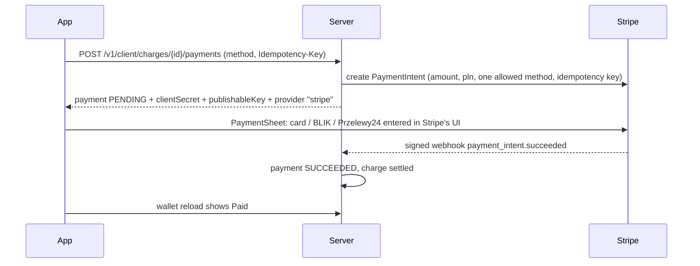

# Stripe payments (test mode)

Clients pay for a session **when they book it**, and pay other online charges from the wallet (B3), with Stripe in **test mode**. No real money moves. The synthetic `fake` provider is still the default, so tests and teammates without Stripe keys work unchanged.

Scope: prepaid single sessions (decision P1 below), cash at the session, wallet payments for online fees, and automatic refunds through Stripe. Out of scope: packages in the client app (hidden for now), Stripe Connect and per-trainer accounts (decision R7: one platform test account), invoices and trainer payouts.

## Decision P1: online sessions are paid when booked

Recorded 2026-11-17 at the product owner's request. It replaces R10 for online sessions booked with "pay now". Cash sessions still create their charge at check-in, as R10 says.

- The booking sheet offers **Pay now online** (the default) or **Cash at the session**. Packages are not offered.
- "Pay now" creates the request and its `SESSION` charge together (`BookingRequestDto.payNow`). The request stays hidden from the trainer (`scheduling.session.awaiting_payment`) until the Stripe webhook confirms the payment. Only then is `session.requested` sent to the trainer, who cannot accept an unpaid request.
- **Not paid.** If the client closes Stripe's sheet, the request is withdrawn right away. If the payment window (30 min) passes without payment, the request expires. In both cases nothing is owed. A payment still being processed (BLIK) keeps the request open.
- **Outcomes** (`billing/Prepaid.kt`, called from the client flow and from the trainer API):

  | What happens | Money |
  |---|---|
  | Trainer rejects, request expires, client withdraws | full refund |
  | Trainer cancels a confirmed session | full refund |
  | Client cancels early (fee 0) | full refund |
  | Client cancels late / no-show (fee F of price P) | F is kept for the fee charge, P − F refunded |
  | Session held (check-in) | nothing; no second charge (same operation id as R10) |
  | Payment succeeds after the request was closed | full refund |

- In the ledger, the session charge gets a `CORRECTION` adjustment, its allocation is reversed, the fee charge is paid from the same payment, and a `billing.refund` row is PENDING. The worker sends PENDING refunds to Stripe, using the refund's operation id as idempotency key, and re-checks the asynchronous ones (BLIK) every 15 s. The wallet shows "refunded X" or "refund of X in progress".

## How a payment works



- The pay call never answers "paid". Only the signed webhook, or Stripe's own intent status, settles a payment.
- The app never sees card or BLIK data. The client secret is kept in memory only and is never logged.
- **Closed sheet.** The app calls `POST /v1/client/payments/{id}/cancel`. The server cancels the intent at Stripe and marks the payment FAILED, so the charge can be paid again. If Stripe is already processing it (for example BLIK confirmed in the bank app), it stays PENDING.
- **Declined card.** `payment_intent.payment_failed` is not final, because the client can retry in the same sheet. Only `succeeded` and `canceled` settle a payment.
- **New attempt.** Before a new payment, unfinished intents for the same charge are cancelled at Stripe. Intents that are processing are kept, and the pay call answers 409.
- **Reconcile job.** `payment-reconcile` runs 15 minutes after each Stripe payment. It applies a webhook that never arrived (from Stripe's status) and cancels a sheet left open (for example when the app was killed).
- Live keys are refused at startup (`sk_test_` / `pk_test_` only).

Code: `server/.../billing/StripePaymentProvider.kt` (behind `PaymentProvider`), `billing/Prepaid.kt`, `BillingService.pay / abandon / reconcile / processRefunds`, migration `V4__prepaid_sessions.sql`, the webhook route `/v1/webhooks/stripe`, `WalletViewModel.onCheckoutResult`, `pl.trainer.ui.ProviderPaymentSheet`, and `androidApp/.../StripePaymentSheetHost.kt`. On desktop there is no Stripe sheet, so a Stripe checkout fails safely and is cancelled.

## Running it locally

1. In the Stripe dashboard (test mode / sandbox, account country Poland), enable Card, BLIK and Przelewy24, and copy the keys from **Developers → API keys**.
2. Put them in the uncommitted `local.properties`:
   ```
   stripe.secretKey=sk_test_...
   stripe.publishableKey=pk_test_...
   stripe.webhookSecret=whsec_...
   ```
   Print the webhook secret once with `stripe listen --print-secret --api-key <sk_test_...>`. It stays the same for that key.
3. Start the database, the webhook forwarder and the server:
   ```bash
   docker compose -f server/docker-compose.yml up -d
   ```
   ```bash
   stripe listen --api-key <sk_test_...> --events "payment_intent.succeeded,payment_intent.canceled,payment_intent.payment_failed" --forward-to localhost:8080/v1/webhooks/stripe
   ```
   ```bash
   ./gradlew "-Ptrainer.ui=false" :server:run "-Ppayment.provider=stripe"
   ```
   The `run` task reads the three keys from `local.properties`. Environment variables (`STRIPE_SECRET_KEY`, `STRIPE_PUBLISHABLE_KEY`, `STRIPE_WEBHOOK_SECRET`, `PAYMENT_PROVIDER`) take precedence. In PowerShell, quote the comma-separated `--events` list, or `stripe listen` treats it as one event name.
4. Run the app with `-Ptrainer.backend=local` and sign in as `klient@example.com`. The publishable key comes from the server with each payment, so the app needs no Stripe configuration.
5. Book: **Calendar → Request a session**, pick a time, accept the policy, keep **Pay now online**, then **Continue: pay**. The trainer (`trener@example.com`) sees the request only after the payment is confirmed. Rejecting or cancelling it refunds through Stripe. Pick a time 12–24 h ahead to see the 50% late-cancellation case.

Test data: card `4242 4242 4242 4242` (any future date and CVC) succeeds, `4000 0000 0000 0002` is declined, and `4000 0025 0000 3155` asks for 3D Secure. In test mode any 6-digit BLIK code is approved after a few seconds, and BLIK refunds complete after a short delay. Payments appear in the Stripe dashboard under the test account.

## Dependency changes

- `com.stripe:stripe-java` 34.1.0 (server). Stripe API version `2026-10-28`, which uses `allowed_payment_method_types`.
- `com.stripe:paymentsheet` 23.24.0 (`androidApp` only).
- `androidApp` `compileSdk` 35 → 36, required by PaymentSheet's AndroidX dependencies. `targetSdk` stays 35, and the shared modules still compile against 35.
