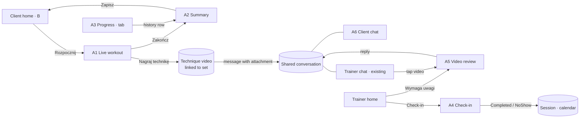

# Feature plan: workout logging, progress, check-in, technique video and chat (Person A)

Status: v0.2, decisions D1–D7 agreed, Q8 open · 2026-11-04 · branch `workout-logging-video` · roles: **client** and **trainer**

Person A builds six views. In this phase they are **views only**: they run on demo data and local storage, with no backend, sync or payment integration. Every backend touchpoint stays behind a repository interface so it can be connected later.

| # | View | Role | Stitch reference |
|---|---|---|---|
| A1 | Trening na żywo (live workout logging) | Client | [01-trening-na-zywo.jpg](workout-logging-video/reference/01-trening-na-zywo.jpg) |
| A2 | Podsumowanie treningu (workout summary) | Client | [02-podsumowanie-treningu.jpg](workout-logging-video/reference/02-podsumowanie-treningu.jpg) |
| A3 | Postępy (progress) | Client | [03-postepy.jpg](workout-logging-video/reference/03-postepy.jpg) |
| A4 | Check-in sesji (session check-in) | Trainer | [04-check-in-sesji.jpg](workout-logging-video/reference/04-check-in-sesji.jpg) |
| A5 | Przegląd wideo techniki (technique video review) | Trainer | No dedicated screen. Built from the video bubble in [05-czat-trener.jpg](workout-logging-video/reference/05-czat-trener.jpg) and the "Wymaga uwagi" card in [06-pulpit-trenera.jpg](workout-logging-video/reference/06-pulpit-trenera.jpg) |
| A6 | Czat – klient (client chat) | Client | [05-czat-trener.jpg](workout-logging-video/reference/05-czat-trener.jpg), mirrored for the client |

Context-only references: [07-start-klient.jpg](workout-logging-video/reference/07-start-klient.jpg) shows where the client enters the workout and the chat; [08-profil-klienta.jpg](workout-logging-video/reference/08-profil-klienta.jpg) shows the trainer's view of the same progress data.

It follows [CLAUDE.md](../../CLAUDE.md) and [initial-architecture.md](../initial-architecture.md), sections 7.1, 9.1–9.3, 10.3 and 10.4. As [context.md](../context.md) says, Stitch gives the direction and style, not a 1:1 spec: we keep the minimal version of each screen.

---

## 1. What already exists and will be reused

| Need | Existing code |
|---|---|
| Theme, typography, spacing, shapes | `shared/designsystem/.../theme` (`AppTheme`, `Spacing`, `AppShapes`, IBM Plex Sans) |
| Set entry row | `shared/designsystem/.../component/SetRow.kt` (`SetRow`, `SetCell`, `SetTableHeader`), already styled after Stitch |
| Buttons, headers, lists, sheets, states, chips | `Buttons.kt`, `Headers.kt`, `Lists.kt`, `Sheets.kt`, `States.kt`, `Chips.kt` (`SegmentedTabs`, `StatusChip`) |
| Plans, planned sets, set types | `shared/domain/.../plan` (`PlanDraft`, `DraftSet`, `SetType`), `contract/.../plan/PlanDtos.kt` (`PlanVersionDto`) |
| Parsing "82,5" / "8-10" | `shared/domain/.../plan/SetInput.kt` |
| Exercises and demo video | `shared/domain/.../exercise`, `shared/feature/workout-builder/.../media` (`DemoVideoCard`, `VideoPlatform`) |
| Media states and upload jobs | `shared/domain/.../media/Media.kt` (`MediaState`: QUEUED → UPLOADING → PROCESSING → READY / FAILED), `shared/data/.../Media.sq` |
| Local database | SQLDelight in `shared/data` (`Plan.sq`, `Exercise.sq`, `Media.sq`) |
| Session statuses, attendance | `shared/src/.../pl/trainer/domain/Models.kt` (`SessionStatus.Completed`, `NoShow`; `TrainerRepository.completeSession`) |
| Trainer chat | `androidApp/.../feature/trainerchats` (list, thread, demo repository) |
| Trainer home entry points | `TrainerHomeDestination.CheckIn(sessionId)` and `TechniqueVideoReview(mediaId)`; today `AppShell.kt:147` answers both with a "not available yet" snackbar |
| Locale formatting | `shared/domain/.../format/LocaleFormats.kt`, `androidApp/.../core/format` |

What does **not** exist yet: workout logs and set logs, assigned plans, body measurements, the client shell and navigation (Person B), media owned by a client, and chat attachments.

---

## 2. Where the code goes

The repository currently has three UI stacks. Each view goes where its data and neighbours already live, so no stack has to be merged as part of this work.

| Part | Location | Why |
|---|---|---|
| A1, A2, A3 | New KMP module `shared/feature/workout-logging` (same layout as `workout-builder`) | Client views; they reuse the KMP plan, exercise and media layers and stay iOS-ready |
| Workout domain | `shared/domain/.../workout` | `WorkoutLog`, `SetLog`, `WorkoutLogReducer`, PR and summary rules, `RestTimer` |
| Workout persistence | `shared/data/.../Workout.sq` and `LocalWorkoutRepository` | Every set saved locally at once |
| A4 | `shared/src/.../pl/trainer/ui/CheckInScreen.kt` | It changes the same `Session` the calendar shows, through `TrainerRepository` |
| A5, A6 and the role-neutral chat | `androidApp/.../feature/chat` (renamed from `trainerchats`) | The chat already lives there and uses `java.time`. Moving it to KMP is a later, separate change |

**To agree with Person B:** the client shell must host A1–A3 and A6. Until it exists, A's screens are reachable through previews and a temporary debug entry. That entry is removed when B's shell lands.

---

## 3. Screens

Each screen has loading, content, empty and recoverable error states unless a row says otherwise. All text goes to string resources (the app is currently Polish only). Dates, weights and durations use the shared formatters.

### A1 Trening na żywo (live workout)

**Purpose:** log sets fast, one exercise at a time, and never lose data.
**Entry:** "Rozpocznij" on the client home (B), or "Pusty trening" for an independent workout (built last, if time allows: **D6**). **Exit:** "Zakończ" → A2.

| Stitch element | Decision |
|---|---|
| Header card: workout name, elapsed time, "Zakończ" | **Keep.** The elapsed time is computed from the stored start time. "Zakończ" is the one primary action; it asks for confirmation when sets are still unticked. |
| "Offline · zapisano na telefonie" | **Keep, as a sync status line**: "Zapisano na telefonie" (local only in this phase). Pending / failed states are modelled now so sync can plug in later. |
| Exercise card with demo video, "Poprzednio: 80 kg × 6", "Ćwiczenie 1/5" | **Keep.** The video uses `DemoVideoCard` and plays only when its media is READY. "Poprzednio" comes from the last working set of the same exercise (architecture 9.1). Show the image smaller than in Stitch. |
| Exercise info icon | **Keep:** opens the exercise detail from `workout-builder` read-only. |
| Set rows: type chip, "Plan: 80 kg × 8", kg / powt. / RPE, tick | **Keep** with `SetRow`. The current set is highlighted. Planned values pre-fill the fields. Ticking saves the set and starts the rest timer. RPE shows only when the plan enables it. |
| "Dodaj serię" | **Keep** as a secondary button. |
| "Nagraj technikę" | **Keep** (core workflow): record or pick a video for the current set → technique video linked to the set → sent to the trainer chat (§4). |
| Rest bar: time left, −15 s / +15 s, skip | **Keep.** Stored as an **end time**, so it is right after the app comes back. When the rest ends, a **system notification** fires even if the app is in the background or was killed (**D7**, §6.1). |
| Moving between exercises | **Add:** swipe or previous/next arrows, plus an exercise list sheet. Stitch does not show it. |
| Overflow menu, top avatar | **Drop** the avatar (the shell owns it). Overflow menu: "Odrzuć trening" with confirmation. |

States: restoring an unfinished workout after process death ("Wróć do treningu"), no assigned plan for today (empty state with a start action), exercise without media (no video area).

### A2 Podsumowanie treningu (workout summary)

**Purpose:** confirm what was done and save it. **Entry:** A1 "Zakończ", or a history row in A3 (read-only). **Exit:** back to client home.

| Stitch element | Decision |
|---|---|
| Duplicated headers, two close buttons, avatar | **Drop.** One `DetailHeader` with back. |
| "Świetna robota, Kasia!" card with date and place | **Keep, smaller.** |
| Time / volume / sets tiles | **Keep:** duration, volume (kg, working sets only) and completed sets. |
| "Nowy rekord życiowy (PR)" | **Keep** only when a PR exists under the rules in 9.1 (no warm-ups, same exercise, comparable units). |
| Exercises with "8/8 serii · 100% planu", RPE, max | **Keep,** as a list without a card per row. Shows planned vs done. |
| Note to the trainer | **Keep** as a plain text field with a counter. **Drop** voice note and emoji. |
| "Zapisz trening" | **Keep** as the one primary action. It is disabled while saving to prevent duplicates. |
| "Dane zostaną natychmiast zsynchronizowane" | **Change:** say what is true: "Zapisano na telefonie. Trener zobaczy trening po synchronizacji." |

### A3 Postępy (progress)

**Purpose:** show the client's own history, records and measurements. **Entry:** client navigation tab (B). It must **not** render its own bottom navigation.

| Stitch element | Decision |
|---|---|
| Tabs Ćwiczenia / Pomiary / Historia / Rekordy | **Keep** with `SegmentedTabs`. |
| Exercise picker and chart with "Estymowany max (1RM)" | **Keep the picker and chart. Change the metric:** plot the best working set (weight × reps) per workout. No estimated 1RM (**D1**). |
| Body measurements (weight, waist, hips) and "Dodaj pomiar" | **Keep.** "Dodaj pomiar" opens a sheet with labelled numeric fields. Measurements are private; demo data is synthetic. |
| Recent workouts list | **Keep without photos.** A row opens A2 read-only. |
| Bottom navigation with centre "LIVE" button | **Not part of this screen:** Person B's client shell. |

A small line chart component is needed. No chart library exists, so add a minimal `LineChart` (Canvas) to `shared/designsystem`, with an accessible text summary. This is a shared change (§5).

### A4 Check-in sesji (session check-in)

**Purpose:** the trainer records attendance for a confirmed session. **Entry:** "Check-in" on the trainer home card (`TrainerHomeDestination.CheckIn`) and, later, the calendar session detail. **Exit:** back, with a snackbar.

| Stitch element | Decision |
|---|---|
| Client, plan, time, place card | **Keep, simpler:** name, time range, place, assigned plan if any. |
| "Obecny" / "Nieobecny" with a grace-period note | **Keep.** "Obecny" → `SessionStatus.Completed` via `completeSession`. "Nieobecny" is disabled until the grace period from the session's policy version has passed (**D2**; demo value 15 min) and then asks for confirmation. The text says that any fee follows the trainer's policy and is calculated by the server. No amount is shown, since there is no server quote in this phase. |
| "Rozliczenie": package / online / cash | **Change:** show how the session is paid, read-only (e.g. "Pakiet: 6 z 8"). Choosing a payment method belongs to the finance flow (**D3**). |
| "Gotowość zawodnika: 94%" | **Drop:** health integrations are later work. |
| "Zakończ check-in i przejdź do treningu" | **Change** to "Potwierdź obecność". Trainer-led workout logging for a client is out of scope (**D4**). |

States: session not yet started (only "Obecny" enabled), already checked in (read-only result), conflict (the session changed elsewhere: reload), offline ("Niewysłane", never shown as done).

### A5 Przegląd wideo techniki (technique video review)

**Purpose:** the trainer watches a client's technique video and answers it. **Entry:** "Wymaga uwagi" card on the trainer home (`TrainerHomeDestination.TechniqueVideoReview(mediaId)`) and tapping a video in the chat. **Exit:** back.

Content, top to bottom:
1. The video player, playable only when READY. Otherwise it shows upload or processing progress, or a failure.
2. The client, the exercise, and the set context ("Seria 3/4 · 110 kg"), plus the date.
3. The client's message, if any.
4. A reply field. Sending posts the reply into the same conversation, quoting the video.
5. One secondary action, "Oznacz jako przejrzane", which removes the item from "Wymaga uwagi".

Recording a correction video ("Korekta…mp4" in Stitch) uses the same picker and is an optional slice.

### A6 Czat – klient (client chat)

**Purpose:** the client's one-to-one conversation with their trainer. **Entry:** chat icon on the client home (B), the trainer name on a session, A1 after a technique video is sent. **Exit:** back.

It looks and behaves exactly like the trainer chat: the same bubbles, composer, date separators and states. Only the header (trainer name) and the entry points differ. In Stitch the trainer's own messages are the dark brand bubbles; with the role-neutral model, "my messages" use that style in both roles.

| Stitch element | Decision |
|---|---|
| Header with avatar, "Aktywna teraz" | **Keep** the name and avatar. **Drop** online presence (needs a backend). |
| Phone and "add session" buttons | **Drop** for now: not part of this scope. |
| Plan strip "Plan: Siła & Rekompozycja · Tydzień 4/8" | **Drop:** the plan is shown elsewhere. |
| Video message with set context, duration and size | **Keep:** a technique video attachment. Tapping opens A5 (trainer) or a player (client). |
| Upload progress "72%" | **Keep:** QUEUED / UPLOADING / PROCESSING / FAILED with retry. |
| Delivery ticks | **Keep** as sent / not sent. Read receipts need a backend. |
| Camera and attachment buttons | **Keep one** "attach video" button. Photos are out of scope. |

---

## 4. How the views work together

**One demo data source per concept, shared by both roles:**

- **Conversations:** one in-memory `DemoChatStore`, keyed by the trainer–client relationship. `TrainerChatsRepository` and the new `ClientChatRepository` both read and write it. A message the client sends appears in the trainer list with an unread count, and the other way round.
- **Technique videos:** one `MediaRepository` with client-owned assets. The trainer home "Wymaga uwagi" item and the chat bubble point to the same `mediaId`.
- **Sessions:** A4 writes through the calendar's `TrainerRepository`. The trainer home currently reads sessions from its own `DemoTrainerHomeRepository`, so its demo session IDs must match the calendar's, or check-in will not be visible on the home card. This is an integration gap to fix with the home owner.

---

## 5. Shared changes (affect other views: announce before merging)

| Change | Affects | Compatibility |
|---|---|---|
| Chat model: `ChatMessage.fromTrainer` → `author: ChatRole`; conversation keyed by relationship ID; optional `attachment: MediaRef` | Trainer chat screens, demo repository, `TrainerChatsViewModelTest` | Trainer UI unchanged; tests updated |
| Package `feature/trainerchats` → `feature/chat` | `AppShell.kt`, `MainActivity.kt`, `TrainerRoute.kt` imports | Mechanical rename |
| `MediaKind` gains `TECHNIQUE_VIDEO`; `MediaAsset.ownerTrainerId` → `ownerUserId`; technique-video limits in `MediaLimits` (60 s, 100 MB: **D5**) | `:contract`, `shared/domain`, `shared/data` `Media.sq` (column rename), workout-builder demo video | Exercise demos keep working |
| `AndroidManifest.xml`: `POST_NOTIFICATIONS`, `SCHEDULE_EXACT_ALARM`, the rest-timer receiver and notification channel | The whole Android app | Additive; first notification permission in the app (§6.1) |
| New `LineChart` in `shared/designsystem` | None yet; Person B may reuse it (Wallet) | New |
| `TrainerRepository.markNoShow(id, revision)` | Calendar demo repository and its tests | Additive |
| `AppShell.kt`: route `CheckIn` and `TechniqueVideoReview` instead of the snackbar | Person B also edits this file (request details) | Small edits, merge often |

---

## 6. Domain and storage (local only)

- `WorkoutLog(id, clientId, sessionId?, assignedPlanVersion?, dayId?, startedAt, finishedAt?, note, state)` with state `IN_PROGRESS → FINISHED`, plus a `syncState` (`LOCAL`, later `PENDING / SYNCED / FAILED / CONFLICT`).
- `SetLog(id = client UUID, workoutLogId, exerciseId, order, type, weightGrams?, reps?, rpe?, durationSec?, distanceM?, completedAt?, techniqueMediaId?)`. Units follow `SetInput` (integer grams and metres).
- `RestTimer(endsAt)` stored with the workout, never a countdown.
- `BodyMeasurement(id, clientId, kind, value, unit, measuredAt)`.
- **Assigned plan:** the assignment flow does not exist yet. A1 reads one `PlanVersionDto` day through a `TodayWorkoutSource` interface backed by a demo fixture. The real assignment flow replaces only that source.
- Pure rules in `shared/domain/.../workout`: `WorkoutLogReducer` (tick, edit, add or remove set), `PreviousPerformance` (last working set), `PersonalRecords` (rules in 9.1), `WorkoutSummary` (duration, volume, planned vs done).
- SQLDelight tables `workout_log`, `set_log`, `body_measurement`. Each set change is written at once, so a killed app resumes the workout.

### 6.1 Rest-timer notification (D7)

The in-app rest bar and the system notification read the same stored `endsAt`.

- **Boundary:** a `RestTimerNotifier` interface in `commonMain` of `workout-logging`, with `schedule(workoutLogId, endsAt)` and `cancel(workoutLogId)`. Android has the real implementation; desktop is a no-op. No Android types enter `commonMain`.
- **When it is called:** the logger ViewModel schedules on every rest start and reschedules on −15 s / +15 s. It cancels on skip, on ticking the next set early, on finishing or discarding the workout, and when the rest has already ended while the app is in the foreground (the in-app bar then gives the feedback, with no duplicate notification).
- **Android:** `AlarmManager.setExactAndAllowWhileIdle` with a `BroadcastReceiver` that posts the notification. If exact alarms are not allowed (`canScheduleExactAlarms()` is false), fall back to `setAndAllowWhileIdle`, which may be a few seconds late. Because the alarm is held by the system, the notification still fires after the process is killed. After a reboot, the workout is restored from the database, and a timer whose `endsAt` is still in the future is rescheduled when the app opens.
- **Channel:** "Odpoczynek", high importance, short sound and vibration. Tapping the notification opens A1 on the current workout.
- **Content:** "Koniec przerwy" and "Czas na serię 3: Wyciskanie sztangi na ławce". Workout content is not on the privacy list (CLAUDE.md §7); it never includes notes, measurements or chat.
- **Permission (Android 13+):** `POST_NOTIFICATIONS` is requested the first time a rest timer starts, after a one-line explanation. If it is denied, the in-app timer works as before, and A1 shows a small inline note once with a link to system settings. It does not ask again on every set.
- **Accessibility:** the notification text is a full sentence, and the in-app bar announces the end of the rest to TalkBack.

---

## 7. Delivery slices

Each slice ends with a buildable app, previews and its tests.

1. **Foundations:** workout domain and reducer, SQLDelight tables, demo `TodayWorkoutSource`, the `workout-logging` module and a temporary debug entry.
2. **A1 live workout:** sets, persistence across process death, rest timer, previous performance, exercise switching.
2a. **Rest-timer notification:** `RestTimerNotifier`, Android alarm and receiver, channel, permission flow (§6.1).
3. **A2 summary:** stats, planned vs done, PRs, note, save once; read-only mode for history.
4. **Role-neutral chat and A6:** shared chat model and `DemoChatStore`, rename, client chat screens; trainer chat still passes its tests.
5. **Technique video:** client-owned media, "Nagraj technikę" in A1, attachment bubble with upload states in both chats.
6. **A5 review:** route from trainer home and chat, reply, mark as reviewed.
7. **A4 check-in:** screen, `markNoShow`, grace-period rule, route from trainer home.
8. **A3 progress:** `LineChart`, exercise history, measurements and the add sheet, records, history list.
9. **Polish and handoff:** large fonts, small screens, TalkBack labels, screenshots in `docs/previews`, then plug A1–A3 and A6 into B's client shell.

A4 does not depend on the others and can be built at any point if the order needs to change.

---

## 8. Decisions and open questions

Agreed on 2026-11-04:

| # | Decision |
|---|---|
| D1 | Postępy plots the best working set (weight × reps) per workout. No estimated 1RM. |
| D2 | The grace period before "Nieobecny" unlocks comes from the session's policy version. Demo value: 15 min. |
| D3 | Check-in shows how the session is paid, read-only. Choosing the payment method and settlement stay in the finance flow. |
| D4 | No workout logging by the trainer on the client's behalf after check-in. The action is "Potwierdź obecność". |
| D5 | Technique videos use the existing demo limits: 60 s and 100 MB. |
| D6 | The model supports an independent workout without a plan. The "Pusty trening" entry is built only if time allows. |
| D7 | The rest timer fires a system notification when the rest ends, also in the background and after the process is killed (§6.1). |

Still open:

| # | Question | Proposal |
|---|---|---|
| Q8 | One shared demo session source for home, calendar and check-in | Agree with the home and calendar owners. Until then, A4 works through the calendar's `TrainerRepository`, and a check-in started from the home card may not show on that card |

---

## 9. Tests that matter

- **Reducer:** ticking, editing, adding and removing sets; planned values pre-fill; warm-ups excluded from volume and PRs.
- **Persistence (jvmTest, in-memory SQLite):** an in-progress workout and its sets survive recreating the repository; set IDs never duplicate on repeated saves.
- **Rest timer:** time left comes from the stored end time with a fake clock, including after "restoring" the app; ±15 s and skip.
- **Rest-timer notification:** with a fake `RestTimerNotifier`, the ViewModel schedules on rest start, reschedules on ±15 s, and cancels on skip, early tick, finish and discard; a restored workout with a future `endsAt` reschedules once. Check on a device that the notification fires with the app killed and that a denied permission leaves the in-app timer working.
- **Summary:** volume, completed vs planned, PR detection against history; "Zapisz" runs once on a double tap.
- **Chat:** a client message appears in the trainer's thread with an unread count, and the other way round; a failed send keeps the draft; an attachment is not playable until READY.
- **Check-in:** "Nieobecny" disabled before the grace period; a double tap on "Obecny" completes once; a stale revision gives a conflict.
- **Progress:** measurement validation (positive numbers, labelled units); chart data uses working sets only.
