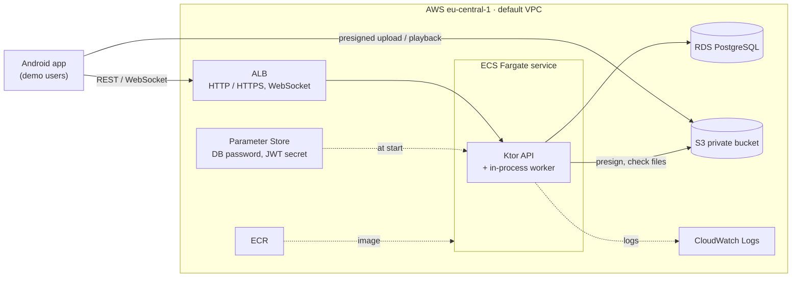

# Infrastructure on AWS (university showcase)

Status: draft v0.2 · 2026-10-28 · proposal for the university phase

This is the **smallest AWS setup that runs the app end to end for a showcase.** It keeps the shape of [initial-architecture.md](initial-architecture.md): a Ktor modular monolith, PostgreSQL as the source of truth (data, ledger, outbox, jobs) and private object storage for media. Anything a demo does not need is left out and listed in section 10, so it can be added later without rewriting code.

Scope decisions for this phase:

- **Authentication is mocked.** No identity provider; the API issues tokens for seeded demo users (section 4).
- **Payments are mocked.** No Stripe; a fake provider stands in behind the same interface (section 4).
- **Synthetic data only.** No real clients, health data or payments, as CLAUDE.md requires for previews and tests.

Prices are rough on-demand figures for `eu-central-1` (Frankfurt); check them in the AWS Pricing Calculator.

---

## 1. Components

| Component | AWS service | Purpose |
|---|---|---|
| Backend | **ECS on Fargate**: one service, one task (0.5 vCPU / 1 GB, ARM) | Runs the Ktor API (REST + WebSocket). The worker runs inside the same process (section 3). |
| Entry point | **Application Load Balancer (ALB)** | A fixed public address for the app, health checks, WebSockets, smooth redeploys. |
| Database | **RDS for PostgreSQL** `db.t4g.micro`, single-AZ, 20 GB | All application data. Not publicly accessible. Automated backups kept for 7 days. |
| Media | **S3**, one private bucket | Technique videos, chat attachments, exercise images. Block Public Access on; default S3 encryption. |
| Container images | **ECR**, one repository | Stores the backend image that ECS runs. |
| Secrets (DB password, JWT signing secret) | **SSM Parameter Store**, SecureString, Standard tier | Free. ECS injects them into the container. Not the RDS-managed secret: it rotates every 7 days and would break the running API's DB connection. |
| Logs | **CloudWatch Logs**, one log group, 14-day retention | Container output for debugging. |
| Access | **IAM**: a task execution role and a task role | Execution role: pull the image, write logs, read the parameters. Task role: read/write only the media bucket. |
| Network | **Default VPC** + three security groups | No custom networking needed (section 5). |
| Cost control | **AWS Budgets** alert | Email at 50 / 80 / 100 % of the monthly limit. |

Outside AWS: GitHub (code and CI), Firebase Cloud Messaging only if push notifications are part of the demo (optional, free).

## 2. What the ALB gives us

The ALB is the one public address the app talks to. ECS starts a new container with a new IP on every deploy; the ALB has a permanent hostname and forwards each request to whichever container is currently healthy.

- **Health check:** the target group calls `GET /health`. A new container gets traffic only once it answers, so a deploy does not break the app.
- **WebSockets:** supported. Set the idle timeout to 300 s and send a ping from the server every 30 s so chat connections stay open.
- **HTTPS (Decision S1):**
  - **No domain:** use the ALB hostname over plain HTTP. Android blocks cleartext traffic by default, so allow it **only in the debug build** with a `network_security_config` entry for that hostname.
  - **With a domain** (about $10–15/year): add a free **ACM** certificate to an HTTPS listener and point a DNS record at the ALB. Then the app uses HTTPS and needs no exception. Preferred if anyone has a domain.

Without an ALB, the app would call the task's public IP directly. That works, but the IP changes on every deploy and there are no health checks. It saves about $20/month.

## 3. The worker runs inside the API

With payments and auth mocked, background work is small: outbox delivery, reminders and media checks. For this phase the worker is a **background coroutine in the API process** that polls the jobs and outbox tables.

- Keep it in its own backend module with its own entry function, so it can become a second ECS service later by changing only the container command.
- Jobs must stay idempotent. When the API scales to two tasks later, use `SELECT … FOR UPDATE SKIP LOCKED` so two pollers never take the same job.

## 4. Mocked authentication and payments

The mocks replace **external services**, not our own rules. Server-side role and relationship checks stay real, because they are part of what the demo shows.

**Authentication**

- The API seeds synthetic users: a trainer, two clients, and a user who is both trainer and client.
- `POST /dev/login {userId}` returns a JWT signed by the API (HS256 with a secret from configuration). The app shows a "Choose demo user" screen instead of a sign-in form.
- Every other endpoint verifies the JWT through Ktor's normal authentication plugin and checks roles and trainer–client relationships against the database.
- Put token issuing behind an interface (e.g. `IdentityProvider`), so a real provider can replace it later without touching endpoints. The dev login route must be disabled by configuration outside the showcase.

**Payments**

- A `FakePaymentProvider` implements the `PaymentProvider` interface from architecture section 4.
- "Pay" creates a pending payment. A job confirms it a few seconds later through the **same code path a webhook would use**, so the app still shows "pending until confirmed", and duplicate confirmations are still ignored.
- Recording a cash payment uses the real ledger (charges, payments, allocations); it needs no provider at all.

**Push notifications (optional)**

- FCM is free and simple to add. If it is skipped, the app refreshes when it opens and on pull-to-refresh. A push only ever tells the app to refresh, so nothing else changes.

## 5. Network and security

The **default VPC** already has public subnets in several Availability Zones, which is all the ALB needs.

| Security group | Inbound | Attached to |
|---|---|---|
| `alb-sg` | 80 (and 443 with a domain) from anywhere | ALB |
| `app-sg` | API port (e.g. 8080) only from `alb-sg` | ECS task |
| `db-sg` | 5432 only from `app-sg` | RDS |

- The ECS task runs in a public subnet **with a public IP**, so it can pull its image from ECR and reach S3 without a NAT gateway. Nobody can call it directly, because `app-sg` accepts traffic only from the ALB.
- RDS has **public access off**. To look at the data, use ECS Exec into the running task, or a temporary rule for a team member's IP that is removed afterwards.
- No SSH, no access keys in code. Team members sign in to the console as IAM users with MFA. (IAM Identity Center and AWS Organizations are not available on the AWS Free plan; joining Organizations upgrades the account to the Paid plan.)

## 6. Media on S3

The flow from architecture section 9.3, simplified for the showcase:

1. The app calls `POST /media/uploads` (kind, size, content type). The API checks the user's role and relationship and the limits (e.g. 60 s, 100 MB), creates a `MediaAsset` in state `UPLOADING`, and returns a **presigned PUT URL** for `uploads-tmp/<assetId>`, valid for 15 minutes.
2. The app uploads the file directly to S3 and shows progress. On failure it asks for a new URL and uploads again.
3. The app calls `POST /media/{id}/complete`. The API sets `PROCESSING` and writes a job in the same transaction.
4. The worker checks that the object exists and matches the limits (size, type; `ffprobe` for duration if included in the image), then moves it to `media/<assetId>` and sets `READY`, or sets `FAILED`. Uploads that are never completed stay under `uploads-tmp/` and are deleted by the lifecycle rule.
5. Playback: `GET /media/{id}/playback` checks access and returns a **presigned GET URL** valid for a few minutes.

- Object keys contain only opaque IDs: `media/<assetId>`, never names or user data.
- A lifecycle rule deletes objects under an `uploads-tmp/` prefix after 1 day, for abandoned uploads.
- Resumable multipart upload (needed for long videos on poor connections) is a later step. A single PUT is enough for short demo clips.

## 7. Delivery

**Local development** needs no AWS account: `docker compose` with PostgreSQL, MinIO (S3-compatible) and the Ktor API. The API reads the S3 endpoint from configuration, so the same code talks to MinIO locally and to S3 on AWS.

**Deploying to AWS**

1. Build the backend image (ARM) and push it to ECR.
2. Update the ECS service to the new image. ECS starts the new task, the ALB waits for `/health`, then the old task stops.
3. Database migrations (Flyway) run when the API starts. With one task this is safe; Flyway locks its history table anyway.

Start with these steps as a short script or manual commands. Automate them later with GitHub Actions using an OIDC role (no stored AWS keys) once the team deploys often.

**Infrastructure setup:** create it once in the AWS console following section 8, and write down any non-default settings. Terraform is worth it only if the environment is rebuilt often.

## 8. Setup checklist

In this order. [aws-setup-guide.md](aws-setup-guide.md) has the click-by-click version with every setting.

1. Budget alert in AWS Budgets.
2. S3 bucket (Block Public Access on), lifecycle rule for `uploads-tmp/`.
3. Security groups `alb-sg`, `app-sg`, `db-sg` (section 5).
4. Parameter Store entries for the DB password and JWT secret; RDS PostgreSQL `db.t4g.micro`, public access off, `db-sg`, self-managed password from that parameter.
5. ECR repository; push the first image.
6. IAM task execution role and task role (S3 access limited to the bucket).
7. ECS cluster, task definition (image, port, environment, DB secret, log group), service with 1 task, `app-sg`, public IP on.
8. ALB with a target group (type IP, health check `/health`) and a listener; attach it to the ECS service.
9. Point the app's debug build at the ALB hostname (or the domain) and log in as a demo user.

## 9. Cost

| Item | Monthly, running all the time |
|---|---|
| ECS Fargate, one task (0.5 vCPU / 1 GB, ARM) | ~$15–20 |
| ALB | ~$20 |
| RDS `db.t4g.micro` + 20 GB storage | ~$15–18 |
| Public IPv4 addresses (ALB and task) | ~$7–11 |
| S3, ECR, CloudWatch (Parameter Store is free) | ~$1–3 |
| **Total** | **~$55–70** |

To spend less:

- Between demos, set the ECS service to 0 tasks and stop the RDS instance (RDS starts itself again after 7 days). The ALB and IPv4 addresses still cost about $1 a day; delete the ALB if there is a long break.
- Use free-tier or education credits if the course provides them.

**AWS Free plan (accounts created after 15 July 2025).** Every service in section 1 is available on the Free plan, and RDS is covered for `db.t4g.micro`. Usage is paid from credits: $100 at sign-up plus $20 each for five onboarding tasks (create a budget, launch an RDS database, launch and terminate an EC2 instance, a Lambda function URL, a Bedrock playground prompt). The Free plan never charges a card, but the account **closes after 6 months or when the credits run out**, whichever comes first; it can be reopened within 90 days by upgrading to the Paid plan. At ~$60/month running all the time, $200 lasts about 3 months, so stop the environment between demos, and take a `pg_dump` and copy the media before the plan ends. Check the current terms on the [AWS Free Tier page](https://aws.amazon.com/free/).

## 10. Later, not now

Add these only when a real need appears; the code stays the same thanks to the interfaces above.

| Need | Addition |
|---|---|
| Real sign-in | A managed identity provider (Cognito in `eu-central-1`, or Firebase Auth) behind `IdentityProvider` |
| Real payments | Stripe Connect behind `PaymentProvider`, webhook endpoint on the ALB, secrets in Parameter Store |
| More load or zero-downtime guarantees | 2+ API tasks; a separate worker service; Multi-AZ RDS |
| Private subnets for the tasks | NAT gateway |
| Public launch | HTTPS required, AWS WAF, AWS Backup, separate dev and prod environments |
| Long videos on poor connections | S3 multipart (resumable) upload |
| Cheaper delivery of public images | CloudFront in front of a public-assets bucket |
| Real users' health data | KMS field-level encryption, audit log, GDPR tooling (architecture section 4) |

## 11. Open decisions

| # | Decision | Proposal |
|---|---|---|
| S1 | Domain and HTTPS | Use a domain + ACM if anyone has one; otherwise HTTP to the ALB in the debug build only |
| S2 | Push notifications in the demo | Optional; add FCM only if the demo shows reminders arriving |
| S3 | Who owns the AWS account and the budget limit | One team account with a budget alert; every member signs in with their own IAM user and MFA |
