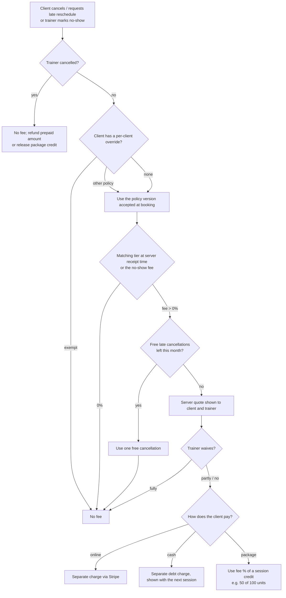
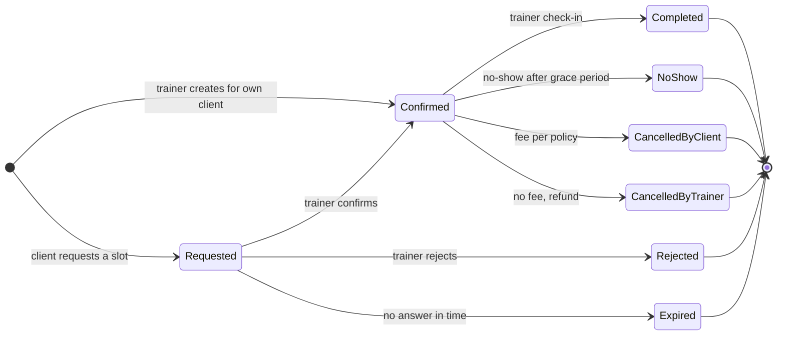
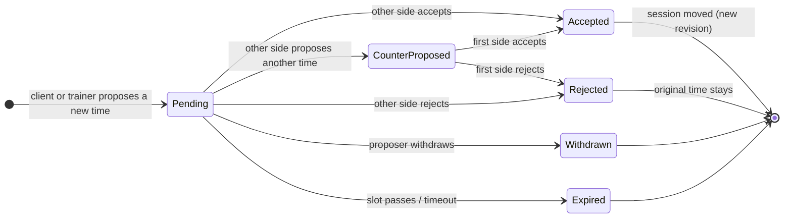
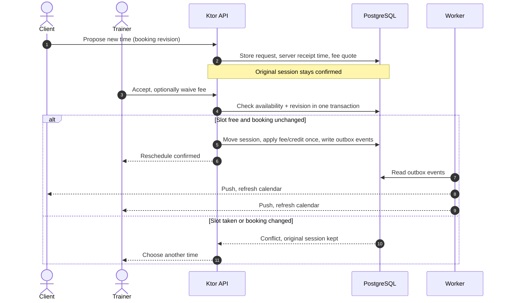
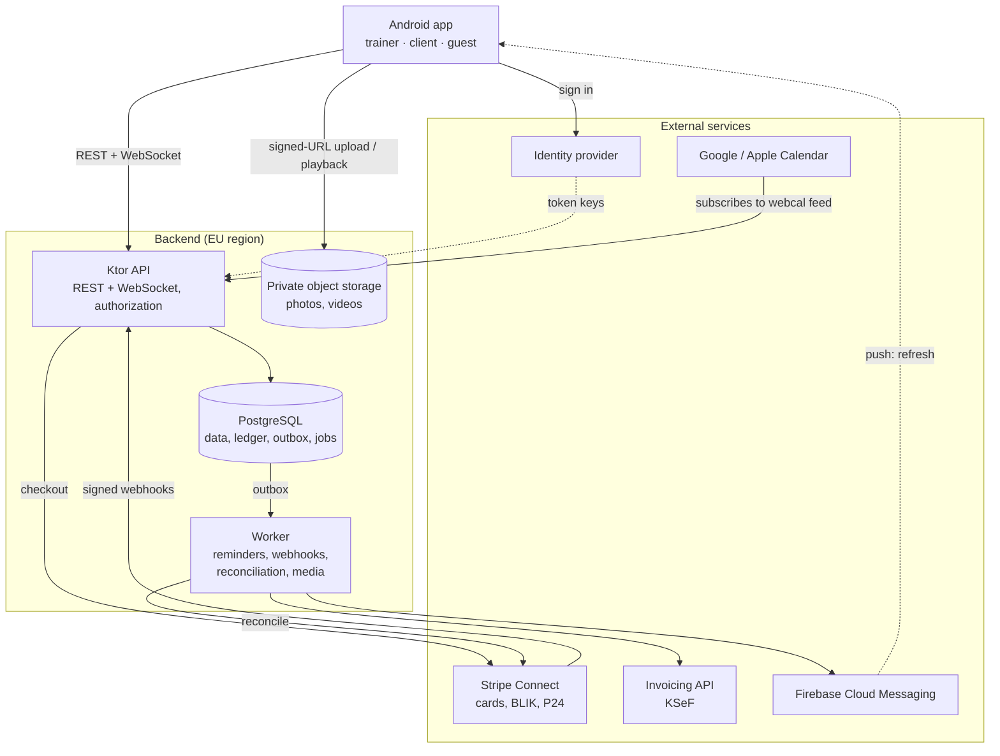
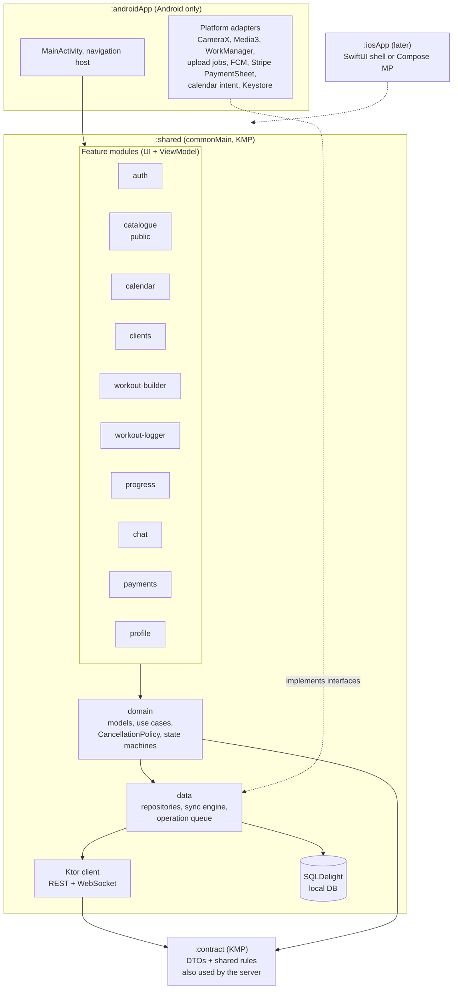
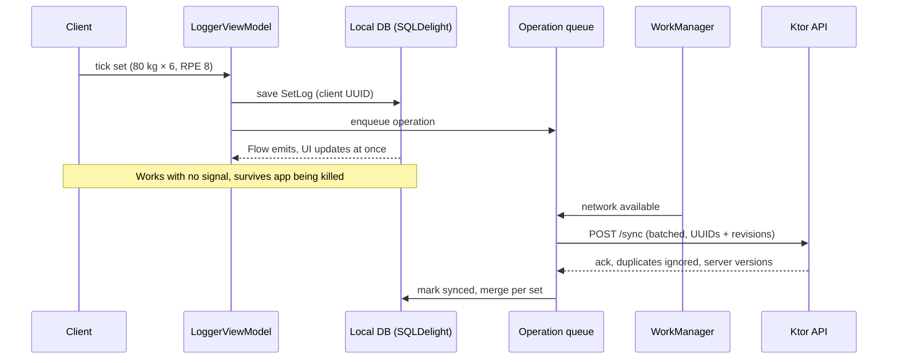
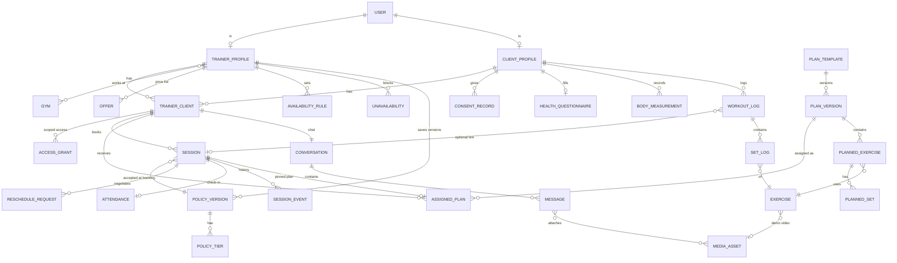
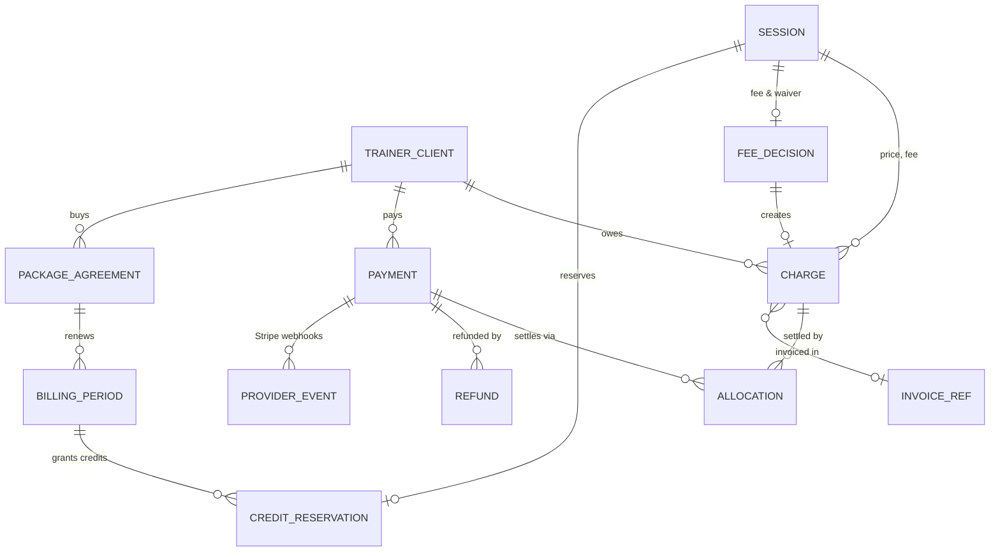

# Trainer App: High-Level Architecture (Android first, iOS later)

Status: draft v0.3 · 2026-10-14 · based on `initial-req.md`, merged with the good ideas from `architecture_gacito.md` (see the changelog at the end)

---

## 1. Feasibility verdict

**Everything in `initial-req.md` can be built in Kotlin.** No requirement is blocked by the platform. In practice the document describes three products in one app:

| Product | Requirements | Difficulty |
|---|---|---|
| **A. Coaching CRM + calendar** | trainer calendar, clients, availability, booking and reschedule flow, check-in, push reminders | Medium (booking conflicts and cancellation rules are the tricky part) |
| **B. Workout logger ("like Hevy")** | exercise library, plan builder, in-session logging, rest timer, history, PRs, charts, body measurements | Medium-high (offline mode, planned-vs-actual model, charts) |
| **C. Marketplace + payments** | public browsing of trainers/gyms/prices, online payments, packages, invoices, cash, cancellation fees | **High** (legal, money, third-party onboarding) |

Chat with **technique video** goes across all three. Video is a core feature: it is in the first end-to-end slice (section 12), not a later add-on.

Risky areas, ordered by risk:

1. **Payments and invoices (C).** Real money, many independent trainers, Polish invoicing law (KSeF), consumer law on cancellation fees. Feasible only with a payment platform that supports marketplaces (Stripe Connect) and an external invoicing service. Never build card handling or invoice numbering yourselves.
2. **Consistency of bookings and money.** Two clients booking the same slot, duplicate or out-of-order payment webhooks, offline retries that charge twice. These are solved with server-side transactions, database constraints and idempotency (sections 7 and 8).
3. **Health data (GDPR Art. 9).** The health questionnaire, injuries and contraindications are special-category data. Body measurements and technique videos are treated as sensitive too. This needs a lawful basis, access control, an audit log, export and deletion.
4. **Video** (trainer exercise demos, client technique videos, chat attachments). Compression, resumable upload, storage cost and playback. Feasible, but it needs its own subsystem and a budget.
5. **Exercise library content.** ExerciseDB (the common GIF source) is commercial and does **not** allow storing its media. Use instead:
   - `free-exercise-db`: public domain, 800+ exercises with images, or
   - wger: CC-BY-SA, so attribution is required,
   - plus **videos recorded by the trainer** (your preferred option anyway).
6. **Offline workout logging.** Gyms often have bad signal, so the logger must work offline and sync later.
7. **Garmin** (later). Garmin's developer program accepts only approved businesses, and new applications have been **paused since Sep 2026**. Plan on Android Health Connect instead (Garmin Connect can sync data into it). Apple Health follows the iOS release.

We cannot estimate delivery yet. Team size, budget, expected number of users and acceptance criteria are not defined (see section 11).

## 2. Gaps and ambiguities to decide as a team

| # | Gap | Proposal |
|---|---|---|
| G1 | **Marketplace or a tool for a trainer's existing clients?** "Browse trainers / gyms / prices" means a marketplace, while the trainer section reads like a CRM. | Both. A client finds a trainer in the public catalogue and sends a request, or joins with the trainer's invite code. Browsing never gives a trainer access to a client's private profile. |
| G2 | **Gyms.** Who creates and maintains gym data? | Trainers attach the gyms they work at. An admin curates the list. Gym capacity and room booking are out of scope unless the team adds requirements. |
| G3 | **Admin role** is missing. | An operator role for listings, exercise content, invoice issues, cash corrections and disputes. MVP: admin flag + DB console; a web panel later. Operators do **not** see health data or chat by default. |
| G4 | **Can a client have more than one trainer?** | Yes. A `TrainerClient` relationship with its own access grants. One user can also hold both roles (a trainer who trains with another trainer). |
| G5 | **"Private calendar events" (trainer).** | A `PrivateEvent` in the app calendar, plus an "Add to calendar" action (Android insert intent) and a subscribable iCal (webcal) feed. The feed updates automatically; a one-off "Add" copy does not, and the app says so. |
| G6 | **Guest mode.** | Guests browse only. Logging needs an account. |
| G7 | **Rates.** | A price list per trainer (service × duration), with an optional per-client override. Each session stores a snapshot of its price and policy. |
| G8 | **Finance** says only "completed sessions × rate". | Separate figures from a billing ledger (section 8): sessions delivered, value, fees, money collected, payouts. |
| G9 | **Time zones, languages, account deletion.** | Store UTC instants plus the IANA time zone (`Europe/Warsaw`). Polish and English. Account deletion in the app and on the web. |
| G10 | **Who books?** | The client **requests** a free slot; the trainer confirms or rejects it. The trainer can also create confirmed sessions directly for their clients. A request is not a booking. |
| G11 | **Can the trainer move a session unilaterally?** The requirements say the trainer "moves" sessions. | Proposal: a trainer's move is a proposal the client accepts, like the client's own request. The original session stays confirmed until both agree. A trainer's move never costs the client anything. |
| G12 | **Who is the seller?** Trainer, gym or platform? | The trainer, by default. This decides who issues the invoice, who refunds and where the money goes, so mark the seller on every offer. |
| G13 | **What does a "monthly subscription" buy?** | **N in-person sessions per month** (a package of session credits). Still to decide: renewal, expiry, rollover of unused sessions, pauses, and the price of extra sessions. A digital-only subscription would be a separate product with store billing (section 4). |
| G14 | **"Overdue payment: yes/no only".** Does the trainer never see amounts? But the trainer records cash. | The client list shows only the yes/no flag. Recording cash needs its own permission and shows the amounts involved. If trainers must never see amounts, an operator has to reconcile cash. |
| G15 | **What works offline?** | Cached plans, history and workout logging work offline. Bookings, fee-bearing actions and payments need the server; offline requests are shown as "not sent". |

## 3. Cancellation and no-show policy (set by each trainer)

Each trainer sets their own rules in **Settings → Cancellation policy**. The platform provides only presets, validation, a live preview and versioning. The trainer can waive any fee.

### 3.1 Trainer configuration panel

| Setting | Type | Default ("Standard" preset) | Validation |
|---|---|---|---|
| Late-cancellation tiers | 1–4 rows: "less than **X h** before → **Y %** fee" | < 24 h → 50%, < 12 h → 100% | Hours 1–168, decreasing; % 0–100, increasing |
| No-show fee | % of session price | 100% | 0–100 |
| No-show grace period | minutes after the start before the trainer can mark a no-show | 15 min | 0–60 |
| Late reschedule counts as cancellation | on/off | on | |
| Free late cancellations | count per calendar month | 1 | 0–10 |
| Cash clients | "add fee to the next session" / "record as debt only" | add to next session | |
| Package clients | "use the fee % of a session credit" / "charge the fee in money" | use credit | |
| Note shown to clients | text | empty | max 300 characters |
| Per-client override | assign another policy, or exempt the client | none | optional |

**Presets** give the trainer a starting point, then every field can be edited:

| Preset | Tiers | No-show |
|---|---|---|
| Flexible | < 12 h → 50% | 50% |
| Standard | < 24 h → 50%, < 12 h → 100% | 100% |
| Strict | < 48 h → 50%, < 24 h → 100% | 100% |

### 3.2 Rules the platform enforces (not configurable)

- **Live preview:** the panel shows the policy as clients will see it, priced with the trainer's own rate. For example: "Free until 24 h before · 12–24 h: 50% (60 zł) · under 12 h: 100% (120 zł) · no-show: 100%".
- **Versioning:** saving creates a new policy version. It applies only to bookings made after that. Existing bookings keep the version the client accepted.
- **Client consent:** the client ticks a checkbox (not pre-ticked) to accept the policy when booking.
- **Server quote:** before any fee-bearing action, the server returns a quote tied to the booking's revision, with an expiry time. If the booking changes or the quote expires, the client sees a fresh quote. For example: "Cancelling now costs 50% (60 zł)."
- **Server time decides:** the fee tier is based on when the **server received** the request, not on when the trainer answers. A slow trainer cannot make the fee higher. An offline request shows "not sent" until the server confirms it, so it cannot silently miss a cut-off.
- **Waiver:** the trainer can waive a fee in full or in part, with an optional reason. This is also how flow step 4 works: a late reschedule request only proposes a fee until the trainer decides.
- **Trainer cancellations** never cost the client anything. A prepaid amount is refunded, or a reserved package credit is released.
- **Warning, not a block:** aggressive settings show a warning, but the trainer still decides. Examples are a 100% fee earlier than 24 h before, or a 100% fee with zero free late cancellations. The warning reads: "Fees this high may be considered an abusive clause under Polish consumer law (art. 385¹ KC)."
- **One calculation for everyone:** fee calculation lives in the shared `:contract` module, so the app preview and the server charge always agree.
- **Corrections are audited:** changing an attendance result (for example a no-show marked by mistake) creates compensating billing records, never edits old ones.

### 3.3 How a fee is decided and settled

**Cash example:** a 120 zł session cancelled in the 50% tier creates a separate 60 zł charge. The next 120 zł session shows two lines, **180 zł** in total. The trainer records 180 zł received; the ledger allocates 60 zł to the old charge and 120 zł to the new session. The new session's price stays 120 zł.

Legal note: Polish studios mostly use a 24 h or 12 h cut-off, so the "Standard" preset matches market practice. Have the client-facing policy text reviewed (UOKiK practice) before a real launch.

## 4. Payments, invoices and compliance: what the research found

None of this is legal advice. Have a lawyer or tax adviser confirm these points before any real-money launch. For the university phase, run Stripe in **test mode**.

**App store billing.** Training delivered in person is a *physical service*. Google Play does not allow Play Billing for physical services, and Apple guideline 3.1.3(d) names one-to-one fitness training as an exception to in-app purchase. So paying through Stripe is allowed.
- **Risk:** digital-only subscriptions (for example "premium plans") **must** go through Play Billing or Apple IAP.
- **Rule for us:** sell only sessions or in-person coaching packages. Workout plans and chat are included extras, never a separately priced digital tier. Mark each product's purpose (physical or digital) in the data model.

**Payment provider.** Use Stripe Connect (Express accounts for trainers), behind our own `PaymentProvider` interface so the vendor can be replaced.
- Supports cards, BLIK and Przelewy24, with the Android PaymentSheet.
- Recurring BLIK is supported: PLN only, up to 2,000 PLN per charge. Przelewy24 does **not** support recurring payments, so packages renew by card or recurring BLIK.
- Stripe, as the licensed institution, holds the money and pays it out to trainers, so the platform does not need a KNF payment licence. That is Stripe's position (PSD2); confirm it with a lawyer.

**Invoices.** The **trainer is the seller** by default (G12), so the trainer issues the invoice. The platform invoices only its own commission, if any.
- B2C invoices (to consumers) are outside mandatory KSeF. Consumers get a PDF on request.
- B2B invoices go through KSeF: mandatory since 1 Apr 2026, with transitional relief until 31 Dec 2026.
- Integrate an invoicing API that already handles KSeF (Fakturownia, inFakt, wFirma) behind an `InvoiceProvider` interface. Store only the issued document's ID, status and download link. Do not build a KSeF client.
- Showing payment history is not the same as issuing invoices; they are separate features.

**Consumer law (14-day withdrawal).** Online purchases of packages need, at checkout:
- information about the withdrawal right,
- a separate checkbox: "start the service before 14 days, and I accept proportional payment", and
- a withdrawal button.

**GDPR.** The health questionnaire, injuries and contraindications are special-category data (Art. 9). Treat body measurements and technique videos as sensitive too.
- **Legal basis:** a contract (Art. 6) for the service itself, plus an Art. 9 condition for health data. Explicit consent is the likely condition, but it must be a real, separate, withdrawable choice per purpose, not a generic checkbox. Store each consent with its version and timestamp, apart from ToS acceptance.
- **Access:** role **and** relationship checks on every private record and attachment. A trainer sees only their own active clients, through scoped access grants that are revoked when the relationship ends. Every read of health data is audit-logged. The public catalogue uses a separate public data view.
- **Hosting and encryption:** EU hosting and a processor agreement (DPA) with every vendor. EU hosting alone does not make the app compliant. TLS everywhere, encryption at rest (database, objects, backups), and field-level encryption for the questionnaire.
- **On the phone:** cache as little health data as possible, and encrypt sensitive local data. Store tokens in the Android Keystore.
- **Where health data must not appear:** push notification text, logs, analytics, calendar feeds or the public catalogue.
- **Retention:** client videos are deleted after a configurable period, and inactive accounts are purged. Invoices must be kept for the legal period even after an account is deleted, so deletion and invoice retention follow different rules.
- **Export and erasure:** self-service data export, plus account deletion both **in the app and on a web page** (Google Play requires both).
- **Before launch:** a DPIA (data protection impact assessment), plus a decision on controller roles (platform vs trainer) in the ToS.
- **Play Console:** the Health apps declaration, the Data safety form and a privacy policy URL.

## 5. Recommended stack

Versions are as of Oct 2026.

| Layer | Choice | Why |
|---|---|---|
| Project structure | **Kotlin Multiplatform from day one**: `shared` (commonMain + androidMain) + `androidApp`; `iosApp` added later | Android-first costs almost nothing extra. Rule: no Android-only libraries (Hilt, Retrofit, Glide) in `commonMain`. |
| UI | **Compose** (Jetpack, with Compose Multiplatform-compatible APIs). One app for guests, trainers and clients. | Compose Multiplatform for iOS has been stable since 1.8 (2025); the current version is 1.12. Decide on shared UI vs a SwiftUI shell when iOS starts. |
| Presentation | MVVM/UDF: `ViewModel` + `StateFlow` (androidx lifecycle KMP). Screens show pending and failed states. | Standard and testable. Screens never touch the database or the payment SDK directly. |
| Navigation | Navigation Compose (multiplatform, type-safe routes) | |
| DI | Koin 4.x | Easiest for students to use with KMP. |
| Network | Ktor client 3.x + kotlinx.serialization | KMP standard. |
| Local DB | SQLDelight 2.x (Room 3 KMP if the team prefers Room) + a persisted **operation queue** | The offline source of truth for the logger and cached plans. |
| Other KMP libs | kotlinx-datetime, DataStore, Coil 3 | |
| Video | CameraX (record), Media3 Transformer (compress on device), Media3 ExoPlayer (play) | Android-native behind a shared `VideoRecorder` / `VideoPlayer` interface. iOS gets AVFoundation later. |
| Background | WorkManager for sync. **User-initiated data transfer jobs** (Android 14+) for large video uploads. | Long uploads need their own lifecycle; a generic background task can be stopped. |
| Push | FCM (it relays to APNs on iOS); KMPNotifier or a thin expect/actual wrapper | Reminders are scheduled **on the server**. A push only tells the app to refresh; it never proves something happened. |
| Backend | **Ktor server (Kotlin), a modular monolith** (section 6), on managed PostgreSQL in the EU. A worker process from the same codebase. | One language across the team. Shares DTOs and rules (fee calculation, state machines) with the app through the `:contract` module. Real transactions for bookings and money. Spring Boot is a valid substitute with the same modules. |
| Jobs and events | **Transactional outbox** + a jobs table in PostgreSQL | A business change and its notification/job are committed together. No message broker needed at this scale. |
| Auth | **External identity provider** (e.g. Firebase Auth, Supabase Auth or Keycloak): email + Google sign-in. The API verifies tokens and makes its own authorization decisions. | Never store passwords ourselves. Roles (client, trainer, operator) and relationships live in our database. |
| Files and video | Private S3-compatible storage in the EU. Direct upload with short-lived signed URLs (resumable/tus). Plain MP4 for the MVP; Mux or Cloudflare Stream only if adaptive streaming is needed. | See section 9.3. |
| Chat | Ktor WebSockets for live updates, REST to catch up after reconnecting, Postgres for storage (1:1 only) | |
| Calendar export | "Add to calendar" (Android insert intent / `.ics`) plus a per-user **iCal (webcal) feed** behind a secret, revocable link | The feed updates automatically and works with Google, Apple and Outlook. Feed titles contain no health data. |
| Payments | **Stripe Connect** (Express): cards, BLIK (recurring too), Przelewy24 (one-off only), PaymentSheet on Android | See section 4. |
| Invoices | Fakturownia, inFakt or wFirma API, connected to KSeF, with invoices in the trainer's name | See section 4. |
| Exercise seed data | `free-exercise-db` (public domain) + trainer uploads | See risk 5 above. |

**Alternative backend:** Supabase (Postgres + RLS + Auth + Storage + Realtime, with the `supabase-kt` KMP client) gives a faster MVP and less server code. The cost is that business logic (fees, booking transactions, Stripe webhooks) moves into SQL or TypeScript Edge Functions and leaves Kotlin. Pick it if the course does not grade backend work.

## 6. Backend modules

One deployable application with clear internal boundaries. A module owns its tables; other modules call it through its Kotlin interface, never by writing its tables. Split into services only if scale or team ownership gives a concrete reason.

| Module | Owns |
|---|---|
| Identity & access | Accounts, roles, token verification, trainer–client relationships, access grants |
| Catalogue | Public trainer and gym profiles, offers, price lists, policy versions |
| Coaching | Goals, health questionnaire, trainer notes, consents |
| Scheduling | Availability, unavailability, booking requests, sessions, reschedule negotiation, attendance |
| Training | Exercise library, plan templates and versions, assigned plans, workout logs, measurements, PRs |
| Messaging | Conversations, messages, workout comments |
| Billing | Charges, payments, allocations, refunds, package credits, fee decisions, invoice references |
| Media | Upload authorization, processing state, playback links, retention |
| Notifications & integrations | Outbox delivery, reminders, push, Stripe and invoicing adapters, calendar feed, later Health Connect |
| Administration | Listing and content management, audited corrections through the owning modules |

## 7. Booking and rescheduling

### 7.1 Lifecycles

The session and the reschedule negotiation have **separate** lifecycles. While a reschedule is being negotiated, the original session stays confirmed.

### 7.2 Rules

- **One transaction on accept.** Accepting a request or move happens in one database transaction. It checks the booking's revision, both people's availability, trainer absences and the new slot. Then it moves the session (keeping the old time in history), moves any package-credit reservation, records the fee decision, and writes outbox events. If anything conflicts, the original session stays as it was.
- **No double booking, enforced by the database.** PostgreSQL exclusion constraints on time ranges (`tstzrange`) per trainer and per client, including an agreed buffer between sessions. The app's own checks are only for the UI.
- **No external calls inside the transaction.** Stripe and push run afterwards, from the outbox, in the worker.
- **Reminders follow revisions.** Each reminder is tied to a session revision. When the session moves, the old reminders are cancelled and new ones are scheduled.
- **Every change** writes a `SessionEvent` (history), updates everyone's calendar and sends a push notification (flow step 3).

### 7.3 Accepting a reschedule

## 8. Billing ledger, packages and trainer finance

- **Append-only ledger.** Rows are never edited; corrections are new rows. The main records:
  - `Charge`: what is owed (session price, late fee, package).
  - `Payment`: money received, online or cash.
  - `Allocation`: which charges a payment settles.
  - `Refund` and `Adjustment` (waivers, corrections).

  A charge is not a payment. A confirmed session paid in cash can still be unpaid.
- **Overdue flag.** "Client has overdue payments" = a charge past its due date that is not fully allocated.
- **Money as integers.** Amounts are `Long` in the smallest unit (grosze), always with a currency code (`PLN`). Never floating point.
- **Idempotency.**
  - Every business operation (charge a fee, grant a package, use a credit) has a unique operation ID with a database unique constraint, and Stripe calls use idempotency keys. A retry can never charge twice.
  - Webhooks: verify the signature, store the event ID, and process each event once. Events can arrive duplicated or out of order, so fetch the current Stripe state when unsure. A nightly reconciliation job compares our records with Stripe.
- **Server-side state only.** The app's "payment successful" screen does not settle a debt. Only a confirmed webhook (or a recorded cash payment) does.
- **Packages (monthly subscription).**
  - A billing period grants N session credits once payment is confirmed. Credits are counted in units of 100 per session.
  - Confirming a session **reserves** 100 units; the outcome uses 0–100 according to the fee tier (for example a 50% late cancellation uses 50 units and releases 50).
  - Credits belong to their billing period. Expiry, rollover and pauses are visible to the client (decisions in G13).
- **Trainer finance** shows separate figures:
  - sessions delivered,
  - value of those sessions,
  - late fees,
  - money owed,
  - money collected,
  - Stripe payouts.

  A package payment is counted once, when it is paid, not again for each session it covers.

## 9. Workouts, chat and media

### 9.1 Plans and workout logs
- **Plan versions.** A `PlanTemplate` has immutable `PlanVersion`s. Assigning a plan to a client (and optionally pinning it to a session) creates an `AssignedPlan` pointing to one version. Editing a template creates a new version and never rewrites what a client was given, so "planned vs done" stays correct. Copying a plan to another client means assigning the same version.
- **Independent workouts.** A `WorkoutLog` may be linked to a session, but a client can also log a workout on their own.
- **Sets.** Each set log stores its type (warm-up, working, drop set), the weight with its unit, reps, RPE/RIR and completion time.
- **PR rules.** PRs ignore warm-up sets and compare only the same exercise in comparable units. "Last time 80 kg × 6" comes from the last working set of that exercise.

### 9.2 Offline sync, rest timer and chat
- **Every set is saved locally at once.** Each change goes into a persisted operation queue with a client-generated UUID and a revision. Sync retries with backoff, and the server deduplicates by UUID. The app survives being killed mid-workout.
- **Conflicts.** Conflicts are resolved per set, never by replacing a whole workout. The UI shows pending, failed and conflicting changes.
- **Rest timer.** The timer stores its end time, not a countdown, so it is correct after the app comes back. A notification fires when it ends.
- **Chat delivery.** Messages have a client-generated ID and a server sequence number per conversation. After reconnecting, the app fetches everything since its last sequence number. WebSocket and push only speed delivery up; the stored messages are the truth. Push text never includes message content.

### 9.3 One media subsystem
The same pipeline handles exercise demos, technique videos and chat attachments:
1. Record or pick the file, compress it on the device (Media3 Transformer), and keep the local file plus a persisted upload job.
2. Ask the API for an upload session, then upload directly to private storage (resumable), with visible progress.
3. The server checks the file before marking it ready. States: `UPLOADING → PROCESSING → READY / FAILED`.
4. Attach the media ID to the message, exercise or workout comment.
5. Every playback is authorized and gets a short-lived signed URL.

Agree on limits: for example, 60 s, 100 MB, 720p H.264. Orphaned uploads are deleted, and retention rules apply (section 4). Storage and bandwidth need a budget.

## 10. Diagrams

### 10.1 System context

### 10.2 Mobile app: modules and layers

### 10.3 Offline workout logging

### 10.4 Domain model: coaching and training

### 10.5 Domain model: billing

Notes on the model:
- `PLANNED_SET` holds reps, weight, RPE/RIR, tempo, rest and a superset group. `SET_LOG` holds the actual values plus the set type and `completedAt`. "Planned vs done" compares the `ASSIGNED_PLAN` version with the `WORKOUT_LOG`.
- Personal records and charts are **derived** (queries or materialised views), not stored by hand.
- `EXERCISE.ownerTrainerId = null` means the global library; otherwise it is the trainer's own exercise.
- `POLICY_VERSION` cannot be changed once saved. It holds the no-show %, the grace period, free cancellations per month, cash and package settings, and the client note. `POLICY_TIER` holds (hours before, fee %).
- `FEE_DECISION` records the quoted fee, the server receipt time, whether a free cancellation was used, the waived amount, the reason and who decided.
- Not drawn: `OUTBOX_EVENT` and `JOB` (reliable follow-up work), and `AUDIT_RECORD` (health-data reads, financial corrections).

## 11. Non-functional targets and key tests

The team still has to set these numbers. They are placeholders to agree on:

| Area | Proposed target |
|---|---|
| Scale for the first release | e.g. 50 trainers, 1,000 clients |
| API response time | p95 under 500 ms for normal reads |
| Video limits | 60 s, 100 MB, 720p |
| Backups | daily, with **a tested restore** before launch |
| Retention | technique videos 90 days; inactive accounts per the privacy policy |

**Monitor:**
- booking conflicts,
- sync failures,
- failed jobs,
- gaps found by payment reconciliation,
- media storage cost.

**Key acceptance tests** (these find the expensive bugs):
1. Two clients book the same slot at the same moment: exactly one succeeds.
2. Duplicate and out-of-order Stripe webhooks: each charge is settled once.
3. Workout logged offline, app killed, phone back online: nothing lost or duplicated.
4. A trainer tries to open another trainer's client profile or video: access denied and logged.
5. A late reschedule for a cash client and for a package client: correct fee, correct credit use, correct "180 zł" next session.
6. The fee shown in the app equals the fee the server charges, for every preset and edge case (same `:contract` code).
7. A session is moved: old reminders are not sent.

## 12. Delivery plan (suggested)

Build one thin **end-to-end slice** first, then widen it, instead of finishing one layer at a time.

| Phase | Scope |
|---|---|
| **0. Foundations** | Decide G1–G15. KMP project, CI, identity provider, backend modules, migrations, outbox, EU environments. |
| **1. First end-to-end slice** | Browse a trainer → sign up → connect (invite or request) → request and confirm a session → assign a plan → log sets offline → upload a technique video → trainer check-in → late-cancel fee from the trainer's policy panel → record a cash payment. Push notifications throughout. |
| **2. Initial release** | Stripe Connect payments, packages and credits, invoices, templates and plan versions, trainer demo videos, all set fields, previous results, rest timer, chat with attachments, PRs and charts, body measurements, calendar feed, consents, data export and account deletion. Test the failure paths in section 11. |
| **3. Marketplace** | Search, gyms directory, operator panel. |
| **4. iOS** | `iosApp` on top of `shared` (Compose Multiplatform or SwiftUI shell), APNs, AVFoundation adapters, later Apple Health. |
| **Later** | Health Connect sync (Garmin data comes through it), Garmin API if its program reopens, two-way calendar sync, recurring bookings. |

The phases only order the work. Technique video, packages and all the requested workout features stay in the target scope of the first release.

---

## Changelog

**v0.3:** merged ideas from `architecture_gacito.md`:
- **Booking:** the request → confirm flow; a separate reschedule-negotiation lifecycle; one-transaction accept with database exclusion constraints.
- **Fees:** server quotes tied to the booking revision, with the tier set by server receipt time; package credits in units of 100.
- **Billing ledger:** append-only, with charges, payments and allocations, idempotency, webhook handling and reconciliation. Money stored as integer grosze. Separate trainer-finance figures.
- **Backend:** a transactional outbox, an external identity provider, and a backend module table.
- **Training:** plan versions and independent workouts; set types and PR rules.
- **Reliability:** the shared media pipeline and video upload jobs; the rest timer stores its end time; chat sequence numbers.
- **Planning:** non-functional targets and acceptance tests; an end-to-end first slice; gaps G10–G15.

**v0.2:** trainer-configurable cancellation policy. **v0.1:** first draft.
