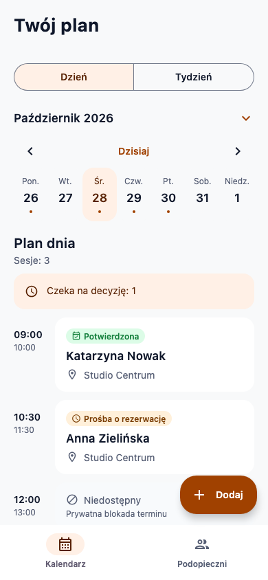
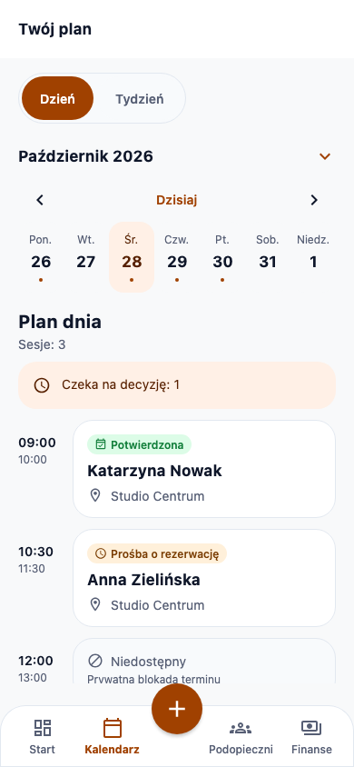
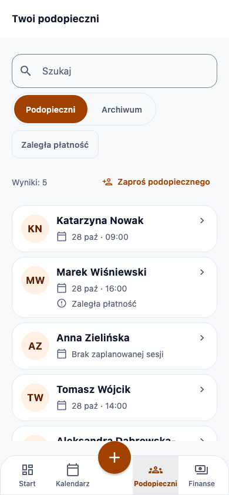

# Design alignment with main

Compared against `origin/main` at **356b4f89323c6d780ea6f1a006fe0b60637eda80**. Changes in this branch align the trainer calendar and trainee views with the useful structural details of main, keeping the established palette and a restrained, practical presentation.

## Findings and applied changes

| Element | Evidence on main | Change in this branch |
| --- | --- | --- |
| Rounded edges | `AppShapes` defines card 16, panel 20, tile 22, media 24 and frame 28 dp. | Added shared 20/22/28 dp tokens. List/action rows use 22 dp; prominent session panels use 28 dp. Inputs retain 16 dp. |
| Surface boundaries | Routine finance rows/tiles use an outline and rounded frame. | Added the existing outline color as a fine 1 dp border around rows and panels. |
| Tabs | `PillTabs` uses an inset, rounded track with a filled selection. | One shared `PillTabs` replaces the default segmented switcher and underlined trainee tabs. It uses our strong brand/white pair and retains 48 dp targets and horizontal scrolling. |
| Header | Shell/detail headers use white, 64 dp chrome with 17/22 bold titles. | Adopted a white header, 64 dp minimum height and shared 17/22 bold title styling. Headers grow for scaled text instead of clipping it to main's fixed height. |
| Typography | Main uses bold 20/26 section and 17/22 item titles. | Updated shared title weights to bold; body sizes remain unchanged. |
| Navigation | Main has a 28 dp upper-corner frame. | Imported main’s four-tab layout and central create control; the rounded upper edge, subtle outline and selected tabs use our shared theme. |
| Buttons | Primary buttons use a pill shape and 52 dp minimum height. | Made both explicit in the shared primary button. The add control uses the same pill geometry. |
| Shadows | Main includes 6–16 dp decorative shadows and brand-colored glows. | Ordinary cards and navigation are flat. Floating controls use 2 dp at rest and 3 dp while pressed/hovered. |

The 20 dp gutter, 16 dp content padding, existing spacing scale and 24 dp section grouping remain consistent. The calendar/trainee screens retain their task-focused layout; main's home photography and translucent photo overlays are not a requirement for these views. Existing actions, data contracts, request lifecycle and archive behavior are preserved.

The inspected sources are [main's shared theme](https://github.com/szczepanikoww/mobile-app-project/blob/356b4f89323c6d780ea6f1a006fe0b60637eda80/androidApp/src/main/kotlin/pl/trainerapp/core/designsystem/Theme.kt), [shared components](https://github.com/szczepanikoww/mobile-app-project/blob/356b4f89323c6d780ea6f1a006fe0b60637eda80/androidApp/src/main/kotlin/pl/trainerapp/core/designsystem/Components.kt), [detail components](https://github.com/szczepanikoww/mobile-app-project/blob/356b4f89323c6d780ea6f1a006fe0b60637eda80/androidApp/src/main/kotlin/pl/trainerapp/core/designsystem/Detail.kt), [shell](https://github.com/szczepanikoww/mobile-app-project/blob/356b4f89323c6d780ea6f1a006fe0b60637eda80/androidApp/src/main/kotlin/pl/trainerapp/shell/AppShell.kt), trainer home and finance screens. Main was inspected from source; the screenshots below are actual renders of this branch, not renders of main.

## Color direction retained

Every existing `Color(0x…)` definition in this branch's shared theme is unchanged. Structural changes consume the same semantic colors.

| Role | Retained pair/value | Migration needed on main |
| --- | --- | --- |
| Filled actions / readable brand text | `#A04100` / white | Main currently reuses `#FF6B00` for filled controls and small text. Separate strong brand from decorative accent. |
| Decorative accent | `#FF6B00` | Keep for corner accents and chart decoration. |
| Tinted brand surface / text | `#FFF0E6` / `#572000` | Replace bright-orange foreground on tinted surfaces. |
| Supporting text | `#565E74` | Replace main's muted `#64748B`. |
| Warning text / surface | `#783B00` / `#FFF0DA` | Replace warning text `#D97706` on pale backgrounds. |
| Error text / surface | `#93000A` / `#FFDAD6` | Replace bright red text/filled semantics with the readable pair. |
| Completed | `#3D5368` / `#E9EEF2` | Split main's combined confirmed/completed green badge. |
| Confirmed | `#15803D` / `#DCFCE7` | Retain confirmed green. |
| Reschedule / waiting | Blue / purple semantic pairs already in our theme | Reuse these when main integrates the scheduling states. |

## Reviewable patch for main

[main-palette-and-surfaces.patch](patches/main-palette-and-surfaces.patch) targets the exact main revision above. It changes five existing files:

- `core/designsystem/Theme.kt`: separates strong brand from decorative accent, aligns foreground/container values, adds completed/warning semantic colors and centralizes the surface outline.
- `core/designsystem/Components.kt`: retains the orange corner accent, uses dark text for the tinted banner, removes the shared panel shadow and uses the shared outline.
- `feature/trainerhome/TrainerHomeScreen.kt`: distinguishes completed sessions, uses the warning container, removes card/button glows and decorative shadows, and makes the outer session frame opaque.
- `shell/AppShell.kt`: removes decorative navigation/profile shadows and reduces the central add button to a neutral 2 dp shadow.
- `feature/trainerfinance/TrainerFinanceScreen.kt`: explicitly keeps chart decoration on the bright accent as the strong action/text color changes.

The patch passes `git apply --check` against an extracted copy of the cited main revision. It is a proposed migration artifact, not an applied merge or a verified Android build of main. Apply it from a checkout containing those main files after copying the patch there:

```sh
git apply --check main-palette-and-surfaces.patch
git apply main-palette-and-surfaces.patch
```

There is also a foundation conflict to resolve during integration: main is Android-only with package `pl.trainerapp`, AGP 8.13.0, Kotlin 2.1.21 and SDK 36.1; this branch has shared Compose plus Android/desktop, package `pl.trainer`, AGP 8.11.1, Kotlin 2.2.21 and SDK 35. This visual alignment does not select a new build stack, namespace or full navigation contract. The eventual merge should provide one shared theme and shell rather than maintain two parallel systems.

## Validation and previews

Verified on this branch:

```sh
./gradlew :shared:desktopTest :desktopApp:classes :androidApp:assembleDebug :androidApp:lintDebug
```

All 27 behavior/UI tests pass, and Android build/lint succeed with the existing non-blocking scaffold warnings. Visual QA covered normal Polish layouts and 320 dp width with 200% text. Palette preservation was checked directly against the committed theme. Native-device keyboard and system-bar checks remain unverified.

| Calendar before | Calendar after |
| --- | --- |
|  |  |

| Trainees before | Trainees after |
| --- | --- |
|  |  |

[Updated profile](previews/trainer-client-profile.png)

## Imported trainer bottom bar

The branch now ports `TrainerBottomBar` / `NavItem` from main's `shell/AppShell.kt` into the shared Compose shell: Start, Calendar, Trainees, Finance and the central 56 dp create control with 24 dp overhang. Selected tabs and the create control use our strong brand color; labels use our supporting text color and the bar uses the shared surface/outline. The bar is flat, with a restrained 2 dp create-button shadow. At 150% text and above, tabs use two rows to keep full labels readable.

Calendar and Trainees retain their existing routes. The create control replaces the calendar's separate floating button and opens the session/availability menu from every tab. Detail/edit routes hide the bottom bar. Start and Finance are explicit integration placeholders; this port does not import main's Android-only feature implementations or resolve the build-stack conflict described above.

Verified with the 27 existing behavior/UI tests (including tab selection, create from Finance, and hidden navigation on editor routes), Android assembly and lint. Updated [calendar](previews/trainer-calendar.png), [trainees](previews/trainer-clients.png), and [200% text navigation](previews/trainer-navigation-font200.png) are actual Compose test renders. Native system-bar/keyboard behavior remains unverified.
